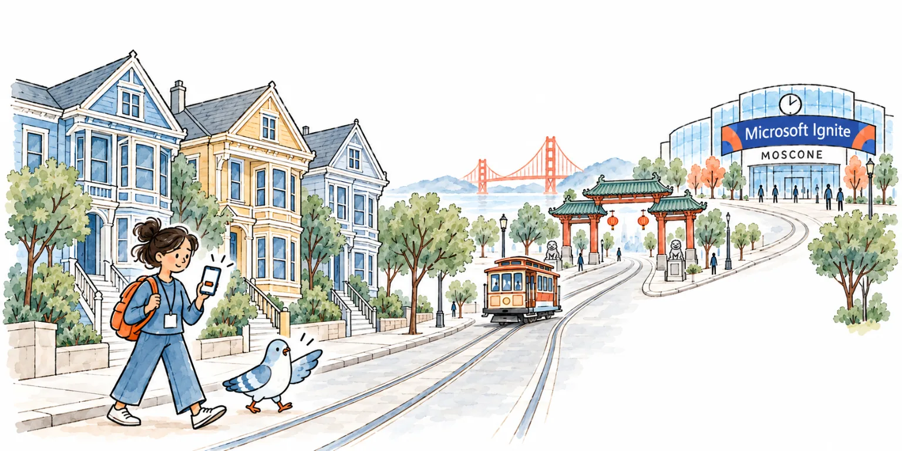
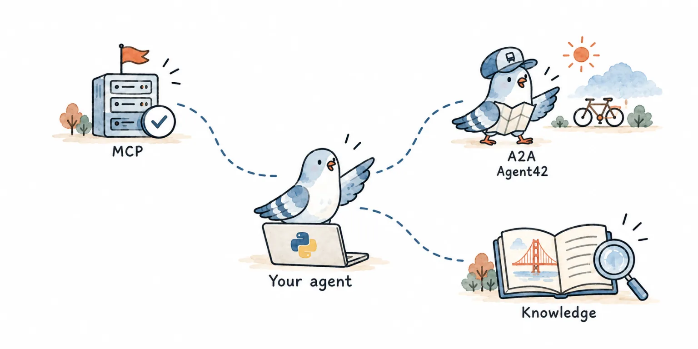
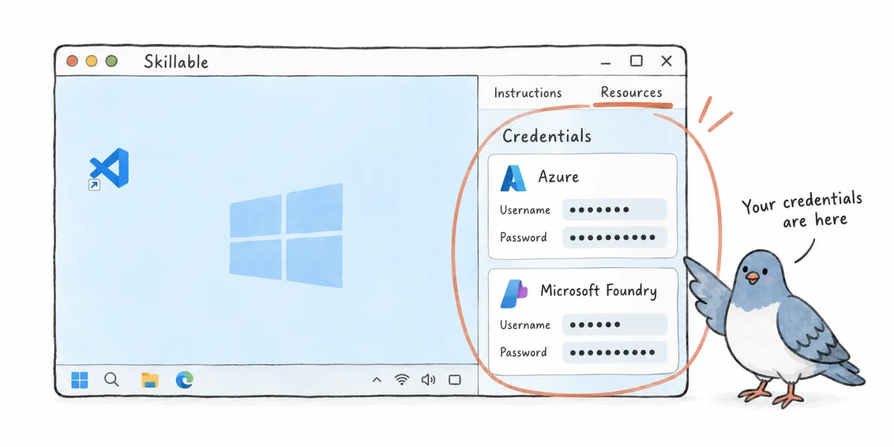
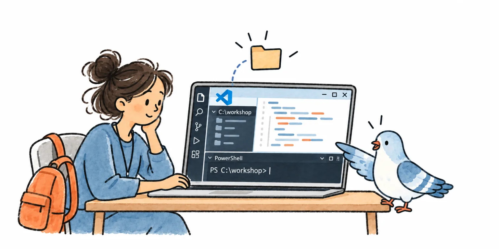
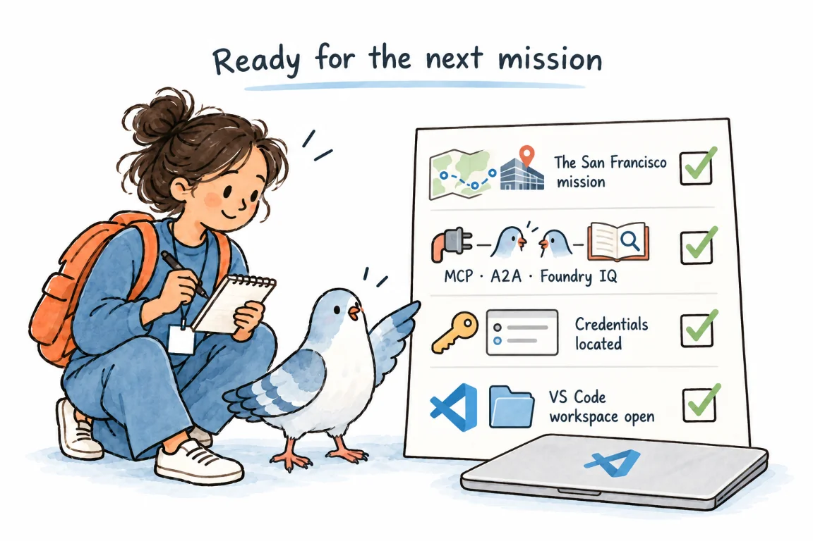

# Welcome

Hi {{ player_name }}, welcome to the **{{ game_name }}** workshop at
{{ game_event }}. We're happy you're here! Today is all about learning by
doing, and we're here to help, so ask questions anytime and enjoy exploring
{{ game_city }} with your agent.

## The Story

{{ game_story }}

You won't be navigating alone. In this workshop you'll build an AI **player
agent** that takes on the *Lost in {{ game_city }}* quest on your behalf. It will:

- Pick up missions from a game server and report back the answers.
- Phone a transport expert, **Agent42**, to decide whether to grab a taxi,
   hop on a bike, or hoof it — based on the weather, traffic, and route.
- Consult a **city guide** knowledge base to dig clues out of {{ game_city }}'s
   neighborhoods, history, food, and hidden corners.

You can see yourself moving around the map of {{ game_city }} on the in-room
display as you progress through the game.

## What You'll Build

A single Python agent, built with the **Microsoft Agent Framework**, that
combines three capabilities you'll add one step at a time:

- **MCP (Model Context Protocol)** — connect to the game server to start
   quests, submit answers, and progress through missions.
   [Read more about MCP](#more-mcp)
- **A2A (Agent-to-Agent)** — call Agent42 as a peer agent for
   weather-aware transport recommendations.
   [Read more about A2A](#more-a2a)
- **Knowledge retrieval** — query a **Foundry IQ** knowledge base over the
   {{ game_city }} city guide to answer the trivia-style missions.
   [Read more about Foundry IQ](#more-foundry-iq)

By the end you'll have a working agent that plays the game end-to-end, and
you'll have seen how the framework, MCP, A2A, and retrieval fit together in
a real application instead of a toy demo.

## Credentials

- Find your Azure and Microsoft Foundry credentials on the **Resources** tab
  in the panel on the right in Skillable.
- Find your game API key on this Player page.

## Your Workspace for Today

> [!Hint] 🖥️ **In VS Code** — you'll do all of this lab's hands-on work in VS Code, except where a step tells you to switch to the browser.

On the Windows desktop, click the **Visual Studio Code** icon to open VS Code.

When VS Code starts, the **C:\workshop** folder should already be open. If that is
not the case:

1. Select **File > Open Folder**.
2. Choose the **C:\workshop** directory.

Open the integrated terminal with **Terminal > New Terminal** and confirm the
terminal is PowerShell and the prompt is inside **C:\workshop**.

## What You Learned

You learned the story of {{ game_name }} and how your agent will play it with
MCP, A2A, and Foundry IQ. You also found where your credentials are and opened
your workspace in VS Code.

