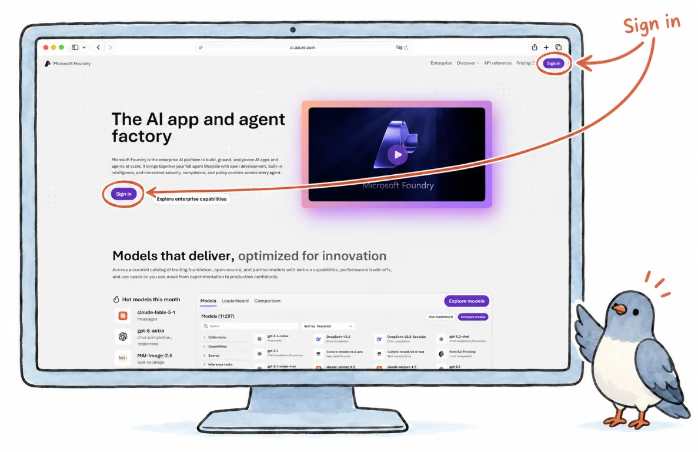
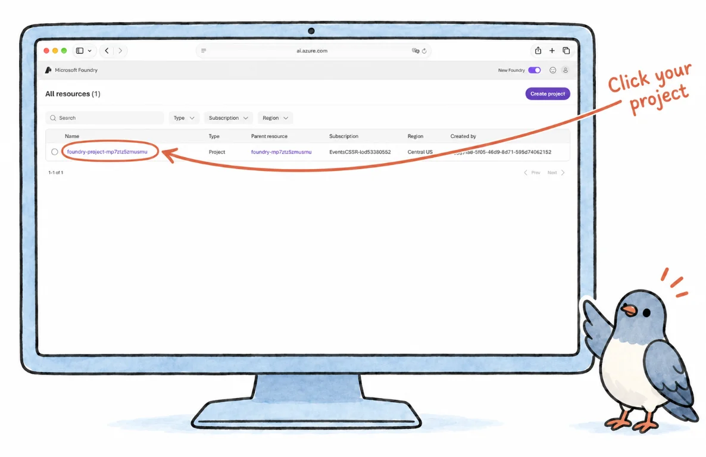
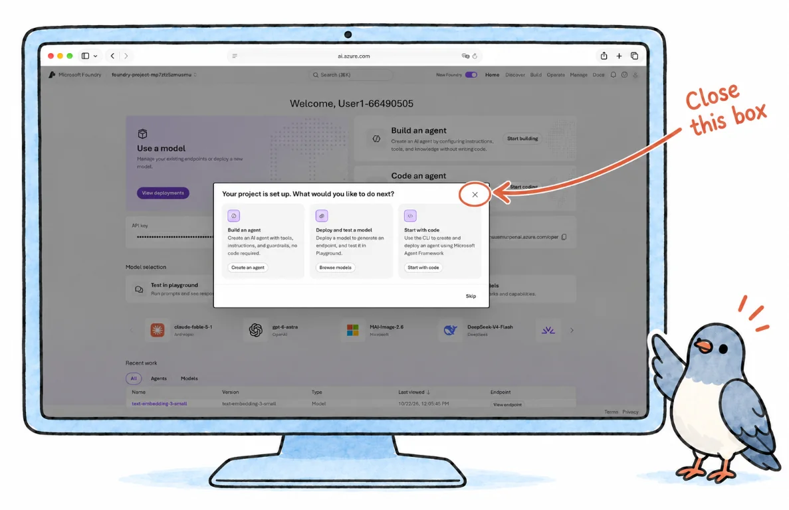
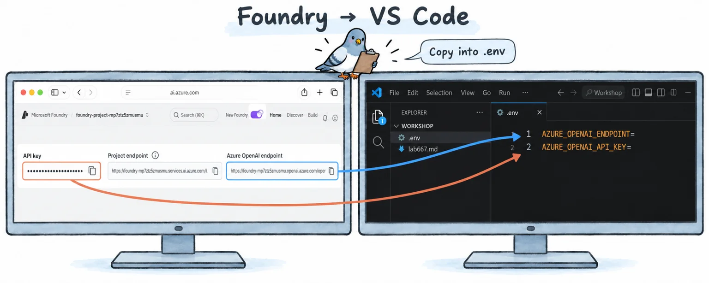
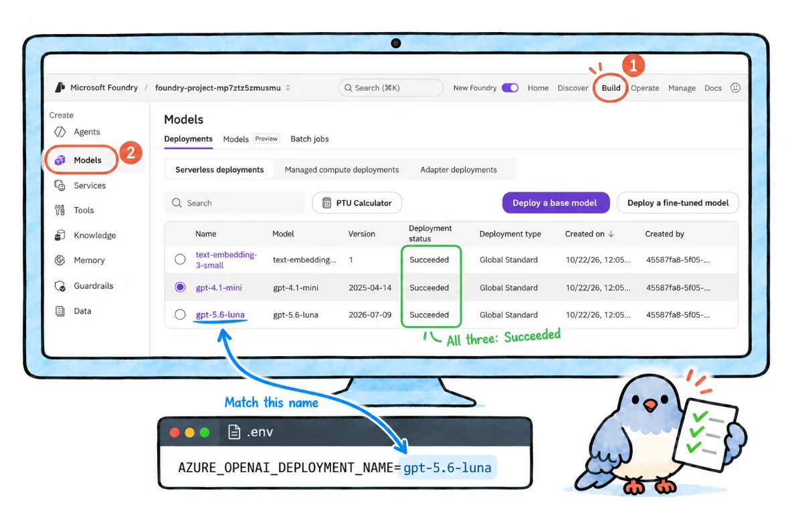
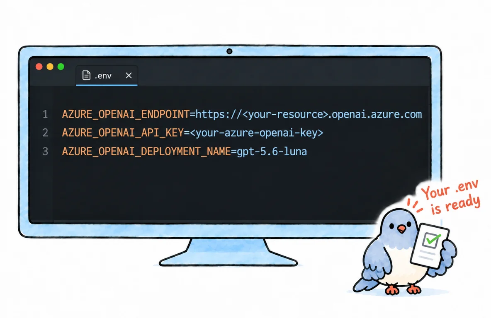
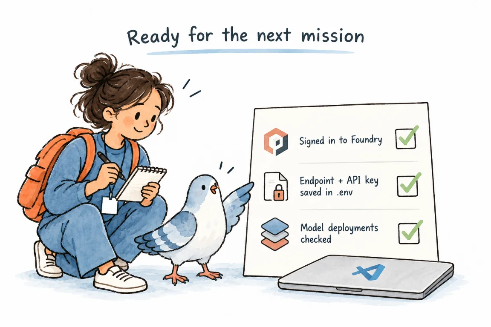

# Get your model endpoint

In this exercise, you collect the connection details from Microsoft Foundry so
the agent can call the deployed chat model. Every later step uses the same
endpoint, API key, and deployment name from the existing **.env** file.
[What is a .env file?](#more-env-file)

## Log in to Microsoft Foundry

1. Open the Edge browser.
2. Navigate to **https://ai.azure.com** in the browser's address bar, if it's not already open.
3. Click **Sign in** in the top-right corner.

4. Sign in with the Microsoft Foundry credentials from the **Resources** tab in Skillable.
5. After you sign in, you see a list of projects. Click the project name.

6. When the **Your project is set up. What would you like to do next?** box appears, click **X** in the top-right corner.

## Get your endpoint details

After you close the box, you should see the Microsoft Foundry home page
with **API key**, **Project endpoint**, and **Azure OpenAI endpoint** boxes near
the top of the page.

1. Open the existing **.env** file in **C:\workshop** in VS Code.
2. Copy the value from the **Azure OpenAI endpoint** box and paste it after
    **AZURE_OPENAI_ENDPOINT=**. Paste it as shown in Microsoft Foundry. The
    agent code removes `/openai/v1` if it appears at the end of the URL.
3. Copy the value from the **API key** box and paste it after
    **AZURE_OPENAI_API_KEY=**.
4. Save **.env**.

## Get your model deployments

The workshop already deployed the models your agent needs in Microsoft Foundry.
Check that they are ready and that your **.env** file uses the right deployment
name for the main model.

1. In the top navigation, select **Build**.
2. Open **Models**.
3. Confirm that these three models are listed and each one has a **Succeeded**
    deployment status:
    - **gpt-5.6-luna**: the main game agent and knowledge base retrieval.
    - **gpt-4.1-mini**: content extraction for the city guide knowledge source.
    - **text-embedding-3-small**: turns the city guide into vectors for search.
4. Confirm that **AZURE_OPENAI_DEPLOYMENT_NAME** in **.env** matches **gpt-5.6-luna**.

## What You Learned

You signed in to Microsoft Foundry, copied your endpoint and API key into the
**.env** file so your agent can use them, and found your model deployments.

