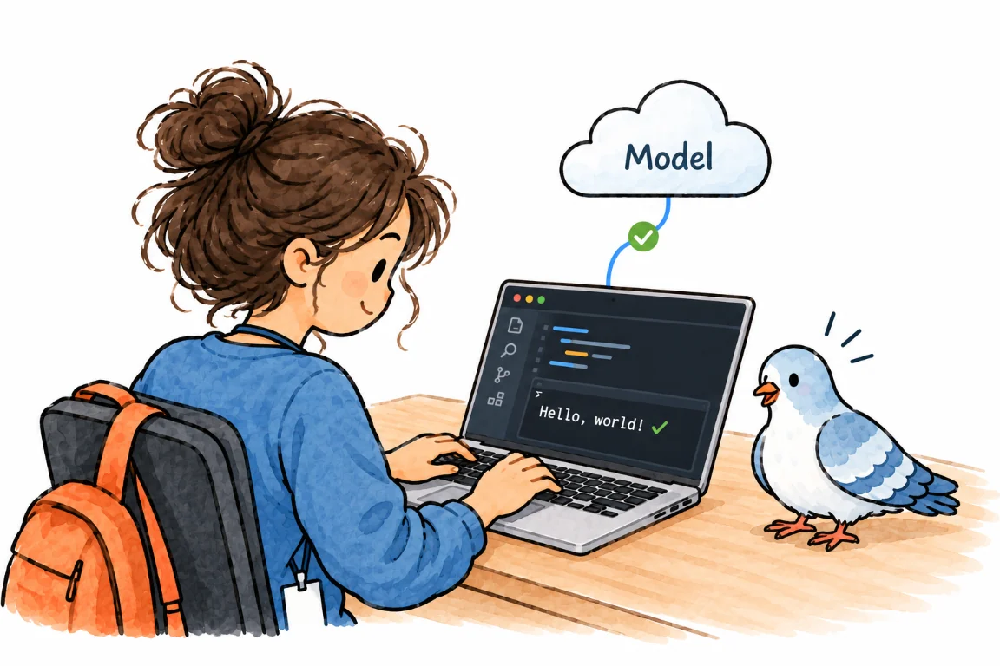
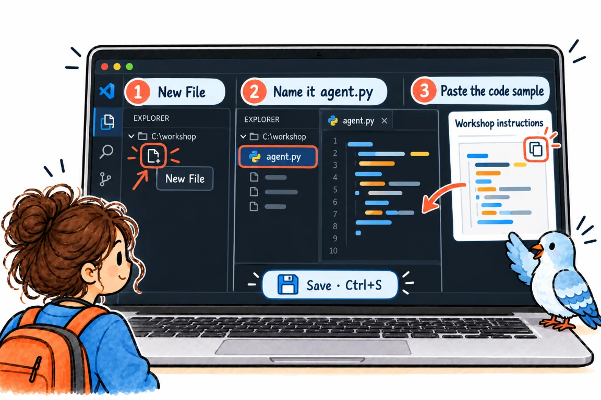
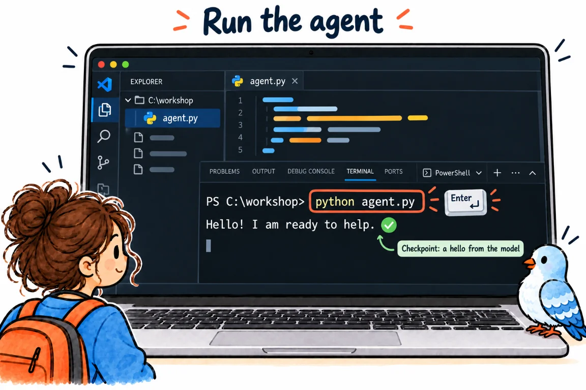
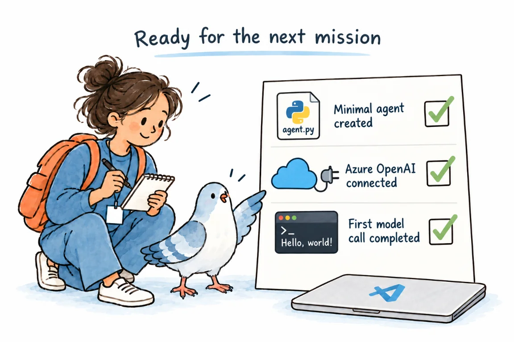

# Create A Hello-World Agent



In this exercise, you create the smallest possible Microsoft Agent Framework
agent so you can prove the model connection works. A simple hello-world run
gives you a clean baseline before MCP, A2A, and retrieval add more moving parts.

> [!Hint] 🖥️ **In VS Code** — this whole step happens in the VS Code editor and terminal.

## Create the agent

In the VS Code Explorer, create a file named **agent.py** in **C:\workshop**.
Paste the full code below into **agent.py** and save the file:



```python-notype
"""Game play agent using Microsoft Agent Framework with Azure OpenAI."""

import asyncio
import os
from pathlib import Path

from agent_framework import Agent
from agent_framework.openai import OpenAIChatClient
from dotenv import load_dotenv

async def main() -> None:
	load_dotenv(Path(__file__).with_name(".env"), override=True)

	client = OpenAIChatClient(
		azure_endpoint=os.environ["AZURE_OPENAI_ENDPOINT"],
		api_key=os.environ["AZURE_OPENAI_API_KEY"],
		model=os.environ["AZURE_OPENAI_DEPLOYMENT_NAME"],
	)

	async with client.client:
		agent = Agent(
			client=client,
			name="Game Play Agent",
			instructions="You are a friendly workshop agent. Reply briefly.",
		)

		response = await agent.run("Say hello to the workshop.")
		print(response.text)


if __name__ == "__main__":
	asyncio.run(main())
```

Not sure what the code above does? Click the button below for a step-by-step
explanation of each part.

[Explain the code](#more-hello-world-code)

## Run the agent

Now run your agent. The terminal in VS Code starts in **C:\workshop**, the same
folder as **agent.py**, so you can start the program with one command. Python
loads your settings from **.env**, connects to your model in Microsoft Foundry,
sends the message, and prints the reply.



Run **agent.py** from the VS Code terminal:

```powershell
python agent.py
```

> **Checkpoint:** the terminal prints a short hello from the model.

## What You Learned

You created a minimal Microsoft Agent Framework agent, connected it to Azure
OpenAI, and made your first model call from **agent.py**.


