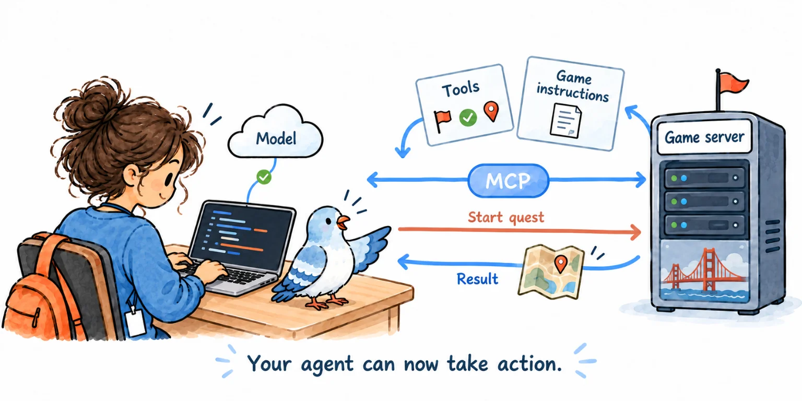
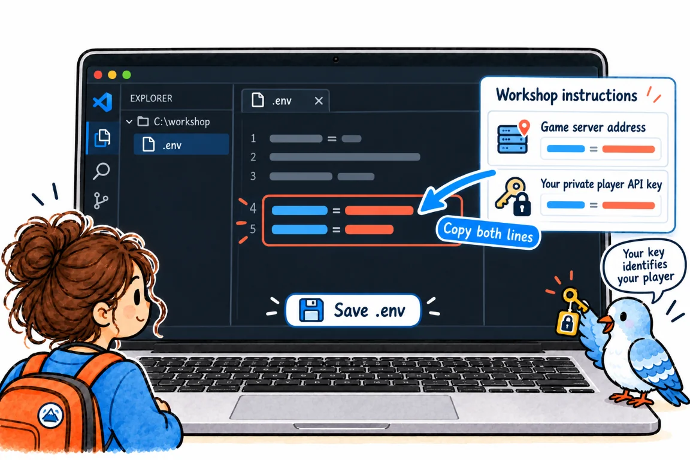
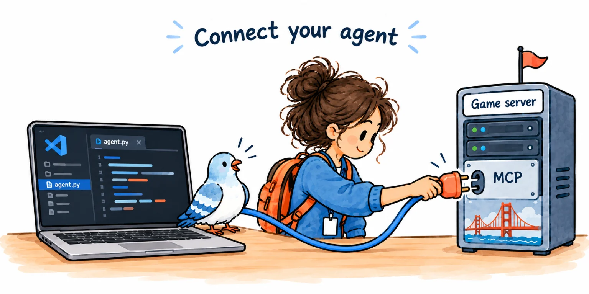
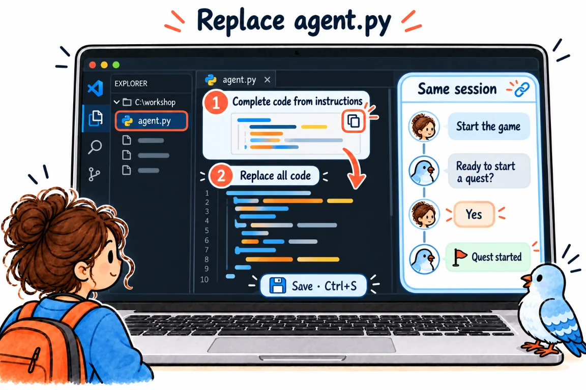
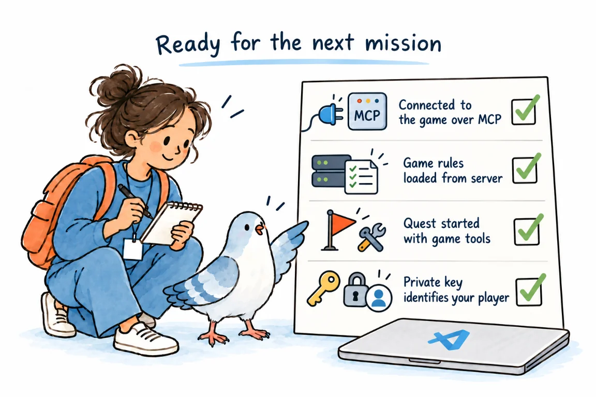

# Connect To The Gaming MCP Server



In this exercise, you connect your agent to the {{ game_name }} game server so
it can play the game. Until now, your agent can only talk to the model. After
this step, it can also take actions in the game.

The game server talks to your agent through MCP (Model Context Protocol). It
shares two things:

- **Tools:** actions the agent can call, such as starting a session, starting a
  quest, submitting a mission answer, and checking the player's status. Each
  tool has a name and a description, so the model knows what the tool does and
  when to use it.
  [Learn more about the tools](#more-game-tools)
- **A prompt:** the game play instructions. The server owns this prompt, so the
  agent always follows the current rules of the game.
  [See the game play prompt](#more-game-prompt)

When the agent connects, it discovers the tools and loads the prompt. From then
on, the model can decide to call a tool, the game server carries out the action,
and the result goes back to the model. That turns the game into something your
agent can act in, not just talk about.

> [!Hint] 🖥️ **In VS Code** — this whole step happens in the VS Code editor and terminal.

## Add endpoint to configuration

Your agent needs two values to reach the game: the address of the game server
and your private API key. The key tells the server which player is acting.



Open the existing **.env** file and add these two lines. They already contain
the address of the {{ game_name }} server and your own API key, so you can copy
them as they are:

```env
GAME_MCP_URL={{ game_mcp_url }}
GAME_API_KEY={{ player_api_key }}
```

> [!Hint] Keep **GAME_API_KEY** private. It identifies your player and authorizes every
> game action. Do not paste it into chat, source code, or session logs.

## Connect the agent



Your agent needs four changes to play the game. Read through them first; at the
end you replace **agent.py** with the complete code.

### 1. Add the dependency

```python-read
from agent_framework import Agent, MCPStreamableHTTPTool
```

**MCPStreamableHTTPTool** is the Microsoft Agent Framework connector for remote
MCP servers. It talks to the game server over HTTP.

### 2. Connect to the tool

```python-read
game_mcp = MCPStreamableHTTPTool(
    name="Gaming MCP Server",
    url=os.environ["GAME_MCP_URL"],
    static_headers={"Authorization": f"Bearer {os.environ['GAME_API_KEY']}"},
)

async with client.client, game_mcp:
    ...
```

**game_mcp** stores where the game server is and sends your API key with every
request, so the server knows which player is acting. The **async with** line
opens the connections to the model and the game server, and closes both when the
block ends, even if something fails.

### 3. Get the game prompt

```python-read
game_play_prompt = await game_mcp.get_prompt("game_play_prompt")
```

This loads the game play instructions from the server. Because the server owns
them, your agent always follows the current rules of the game.

### 4. Add the MCP server to the tools

```python-read
agent = Agent(
    client=client,
    name="Game Play Agent",
    instructions=game_play_prompt,
    tools=[game_mcp],
)
```

The agent uses the game prompt as its instructions. **tools=[game_mcp]** gives it
every game tool, such as starting a quest and submitting an answer. The model
decides when to call them.

## Replace agent.py



Replace everything in **agent.py** with the code below and save the file. It
combines the four changes and ends with a short conversation: the first message
asks to start the game, and **Yes** starts the quest. Both messages use the same
**session**, so the agent remembers the first answer when it reads the second.

```python-notype
"""Game play agent using Microsoft Agent Framework, Microsoft Foundry, and MCP."""

import asyncio
import os
from pathlib import Path

from agent_framework import Agent, MCPStreamableHTTPTool
from agent_framework.openai import OpenAIChatClient
from dotenv import load_dotenv

async def main() -> None:
    load_dotenv(Path(__file__).with_name(".env"), override=True)

    client = OpenAIChatClient(
        azure_endpoint=os.environ["AZURE_OPENAI_ENDPOINT"],
        api_key=os.environ["AZURE_OPENAI_API_KEY"],
        model=os.environ["AZURE_OPENAI_DEPLOYMENT_NAME"],
    )

    game_mcp = MCPStreamableHTTPTool(
        name="Gaming MCP Server",
        url=os.environ["GAME_MCP_URL"],
        static_headers={"Authorization": f"Bearer {os.environ['GAME_API_KEY']}"},
    )

    async with client.client, game_mcp:
        game_play_prompt = await game_mcp.get_prompt("game_play_prompt")

        agent = Agent(
            client=client,
            name="Game Play Agent",
            instructions=game_play_prompt,
            tools=[game_mcp],
        )

        session = agent.create_session()

        response = await agent.run("Hi, can we start the game?", session=session)
        print(response.text)

        response2 = await agent.run("Yes", session=session)
        print(response2.text)


if __name__ == "__main__":
    asyncio.run(main())
```

Run the agent from the VS Code terminal:

```powershell
python agent.py
```

Here is what the conversation looks like. The game gives each player one of
several quests, so your story and route may be different. The agent's own words
can also change a little from run to run. The terminal shows only the agent's
replies; your two messages come from **agent.py**.

```output-read
You:
Hi, can we start the game?

Agent:
Welcome, {{ player_name }}. Your player session is connected and your quest is ready, but it has not begun yet. Do you want to START?

You:
Yes

Agent:
+--------------------------------+
| Welcome to:                    |
| Lost in San Francisco          |
+--------------------------------+

You step out of a taqueria on Valencia Street and find a Microsoft Ignite 2026 badge in your jacket pocket. Your phone lights up: 9:15am. The opening session starts at 10:00 at Moscone Center. You have forty-five minutes, a half-charged battery, and one message from the event team: follow the city guide, collect the clue, and get to SoMa.

A delivery bike rattles past while a street musician plays near the curb. Behind you, a mural of impossible colors seems to point downtown.

The Mission is already fully awake: cafe lines, bus brakes, and shop gates rolling open. A message on your badge sends you to Hayes Valley, where an Ignite volunteer is holding the clue you need before you can head downtown.

You need to get from 515 Valencia St, San Francisco, CA 94110 to 544 Hayes St, San Francisco, CA 94102. What transport will you take: car, walking, or bike? There are agents that can help lost travellers. Just ask for HELP.
```

The program ends after these two messages. In the next mission, you add Agent42
to help with travel choices and a chat loop to keep playing.

> [!Hint] Look at the **Live progress** bar at the top of this page. After you
> say **Yes**, it shows **Quest started** and "You set off on {{ player_quest }}."

## What You Learned

You connected your agent to the {{ game_name }} game server over MCP. Your agent
now loads the game rules from the server, uses the game tools to start your
quest, and acts as your player with your private API key.


