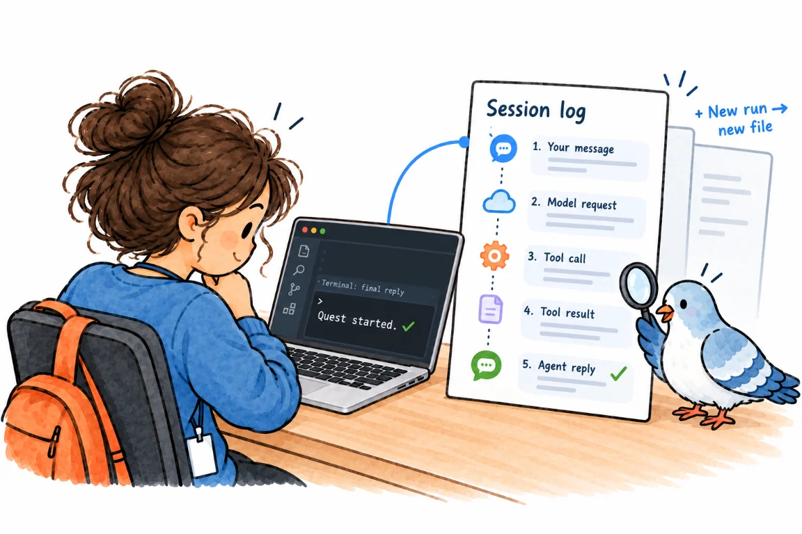
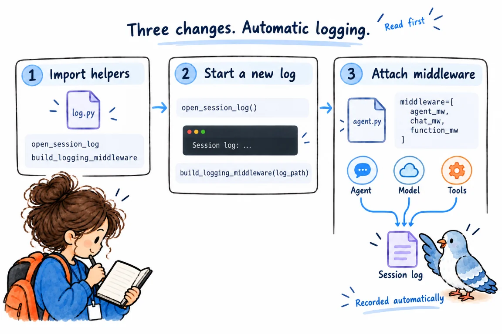
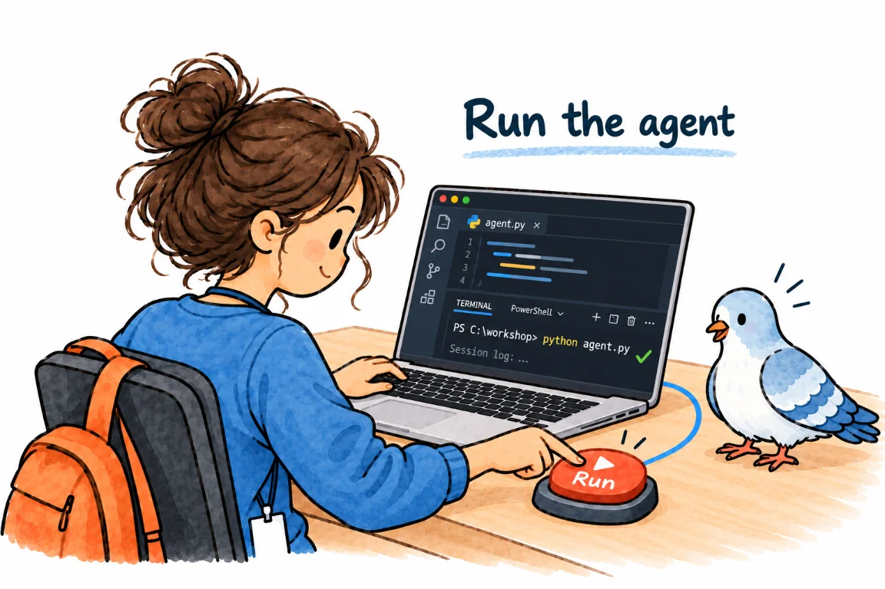
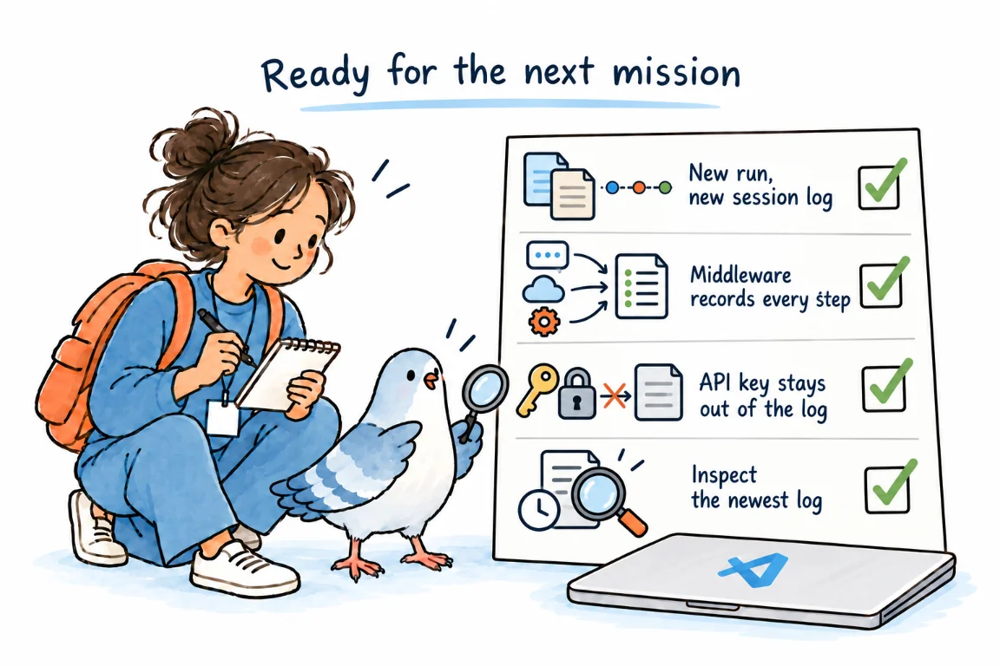

# Add Session Logging



In this exercise, you add a session log to your agent. Each time you run the
agent, it writes a new file that records what happened behind the scenes.

Your agent does more than reply. Before it answers, it can send your message to
the model, call one or more game tools, and read their results. You only see the
final answer in the terminal. The session log shows every step in order: your
message, what the model received, each tool call and its result, and the agent's
reply. That makes it easy to see why the agent did something, or to find out
what went wrong.

> [!Hint] 🖥️ **In VS Code** — create the logging helper beside **agent.py** in
> **C:\workshop**.

## Create the logging helper

The logging code lives in its own file, **log.py**, next to **agent.py**. That
keeps **agent.py** short: it only needs to import the helper and switch it on.

1. In the VS Code Explorer, select the **C:\workshop** folder.
2. Select **New File** and name it **log.py**.
3. Copy the code below with the **Copy** button and paste it into **log.py**.
   VS Code saves the file automatically.

```python-notype
"""Per-session conversation and tool I/O logging."""

import json
import uuid
from collections.abc import Awaitable, Callable, Sequence
from datetime import datetime
from pathlib import Path
from typing import Any

from agent_framework import (
    AgentContext,
    AgentResponse,
    ChatContext,
    Content,
    FunctionInvocationContext,
    Message,
    agent_middleware,
    chat_middleware,
    function_middleware,
)
from pydantic import BaseModel

LOGS_DIR = Path(__file__).resolve().parent / "logs"


def open_session_log() -> Path:
    LOGS_DIR.mkdir(exist_ok=True)
    stamp = datetime.now().strftime("%Y%m%d-%H%M%S")
    path = LOGS_DIR / f"session-{stamp}-{uuid.uuid4().hex[:6]}.log"
    path.write_text(
        f"# Session log started {datetime.now().isoformat()}\n\n",
        encoding="utf-8",
    )
    return path


def _append(path: Path, header: str, body: str) -> None:
    timestamp = datetime.now().strftime("%H:%M:%S")
    with path.open("a", encoding="utf-8") as file:
        file.write(f"[{timestamp}] {header}\n{body.rstrip()}\n\n")


def _truncate(text: str, limit: int = 4000) -> str:
    return text if len(text) <= limit else text[:limit] + "\n... [truncated]"


def _stringify(value: Any) -> str:
    def serialize(item: Any) -> Any:
        if isinstance(item, Content):
            return item.to_dict()
        if isinstance(item, BaseModel):
            return item.model_dump(mode="json")
        return str(item)

    return json.dumps(value, indent=2, default=serialize, ensure_ascii=False)


def _format_messages(messages: Sequence[Message]) -> str:
    return "\n".join(
        f"[{message.role}] {message.text}"
        for message in messages
        if message.text
    )


def build_logging_middleware(log_path: Path):
    @agent_middleware
    async def log_agent(
        context: AgentContext,
        call_next: Callable[[], Awaitable[None]],
    ) -> None:
        text = _format_messages(context.messages)
        if text:
            _append(log_path, "USER ->", _truncate(text))
        await call_next()
        if isinstance(context.result, AgentResponse) and context.result.text:
            _append(log_path, "AGENT <-", _truncate(context.result.text))

    @chat_middleware
    async def log_chat(
        context: ChatContext,
        call_next: Callable[[], Awaitable[None]],
    ) -> None:
        text = _format_messages(context.messages)
        if text:
            _append(log_path, "MODEL INPUT ->", _truncate(text))
        await call_next()

    @function_middleware
    async def log_function(
        context: FunctionInvocationContext,
        call_next: Callable[[], Awaitable[None]],
    ) -> None:
        _append(
            log_path,
            f"TOOL CALL {context.function.name}",
            _truncate(_stringify(context.arguments)),
        )
        await call_next()
        _append(
            log_path,
            f"TOOL RESULT {context.function.name}",
            _truncate(_stringify(context.result)),
        )

    return log_agent, log_chat, log_function
```

What **log.py** does:

- **open_session_log()** creates a **logs** folder next to **log.py** and starts a
  new log file with the date and time in its name.
- **build_logging_middleware()** returns three small functions that the agent
  calls automatically: one for each message to and from the agent, one for
  each request to the model, and one for each tool call and its result.

Your API key never ends up in the log, because it isn't part of the
conversation. It's a bearer token: the connection sends it in the
**Authorization** header of each request to the game server. The log only
records messages and tool calls, so the key never appears there.

## Add logging to the game agent

Your agent needs three changes to write the session log. Read through them
first; at the end you replace **agent.py** with the complete code.



### 1. Import the helper

```python-read
from log import build_logging_middleware, open_session_log
```

This loads the two functions from **log.py**, the file you just created.

### 2. Start a new log

```python-read
log_path = open_session_log()
print(f"Session log: {log_path}")
agent_mw, chat_mw, function_mw = build_logging_middleware(log_path)
```

**open_session_log()** creates a new log file for this run, and **print** shows
its location in the terminal so you can open it later.
**build_logging_middleware()** returns the three logging functions, all writing
to that file.

### 3. Add the logging to the agent

```python-read
agent = Agent(
    client=client,
    name="Game Play Agent",
    instructions=game_play_prompt,
    tools=[game_mcp],
    middleware=[agent_mw, chat_mw, function_mw],
)
```

**middleware** is code that runs around everything the agent does. The agent
calls the three logging functions automatically, so you don't need to add any
logging calls yourself.

[What is middleware?](#more-middleware)

## Replace agent.py

Now put the three changes together. Replace everything in **agent.py** with the
code below. It's the same agent you built to play the game, now with session
logging switched on.

```python-notype
"""Game play agent using Microsoft Agent Framework, Azure OpenAI, MCP, and session logging."""

import asyncio
import os
from pathlib import Path

from agent_framework import Agent, MCPStreamableHTTPTool
from agent_framework.openai import OpenAIChatClient
from dotenv import load_dotenv

from log import build_logging_middleware, open_session_log

async def main() -> None:
    load_dotenv(Path(__file__).with_name(".env"), override=True)

    client = OpenAIChatClient(
        azure_endpoint=os.environ["AZURE_OPENAI_ENDPOINT"],
        api_key=os.environ["AZURE_OPENAI_API_KEY"],
        model=os.environ["AZURE_OPENAI_DEPLOYMENT_NAME"],
    )

    log_path = open_session_log()
    print(f"Session log: {log_path}")
    agent_mw, chat_mw, function_mw = build_logging_middleware(log_path)

    game_mcp = MCPStreamableHTTPTool(
        name="Gaming MCP Server",
        url=os.environ["GAME_MCP_URL"],
        static_headers={"Authorization": f"Bearer {os.environ['GAME_API_KEY']}"},
    )

    async with client.client, game_mcp:
        game_play_prompt = await game_mcp.get_prompt("game_play_prompt")

        agent = Agent(
            client=client,
            name="Game Play Agent",
            instructions=game_play_prompt,
            tools=[game_mcp],
            middleware=[agent_mw, chat_mw, function_mw],
        )

        session = agent.create_session()

        response = await agent.run("Hi, can we start the game?", session=session)
        print(response.text)

        response2 = await agent.run("Yes", session=session)
        print(response2.text)


if __name__ == "__main__":
    asyncio.run(main())
```



Run the agent from the VS Code terminal:

```powershell
python agent.py
```

The first line in the terminal shows where the log was saved, for example
**Session log: C:\workshop\logs\session-20261022-174742-bbe05b.log**. Open that
file in VS Code. It lists every step of the run in order:

```output-read
[17:47:43] USER ->
[17:47:43] MODEL INPUT ->
[17:47:43] TOOL CALL begin_session
[17:47:43] TOOL RESULT begin_session
[17:47:43] MODEL INPUT ->
[17:47:43] AGENT <-
[17:47:43] USER ->
[17:47:43] MODEL INPUT ->
[17:47:43] TOOL CALL start_quest
[17:47:43] TOOL RESULT start_quest
[17:47:43] MODEL INPUT ->
[17:47:43] AGENT <-
```

Each heading is followed by the text of that step. The first run shows your
**Hi, can we start the game?** message, the call to **begin_session**, and the
welcome. The second shows **Yes**, the call to **start_quest**, and the opening
scene.

## What You Learned

You added a session log to your agent. Each run now writes a new file that shows
every step the agent takes: your message, what the model received, each tool
call and its result, and the agent's reply.

You built it with middleware: small functions that the agent runs automatically
around every step, so your agent code didn't need any logging calls. Your API
key stays out of the log, because it travels as a bearer token in the
connection, not in the conversation.

When your agent does something unexpected in the next missions, open the newest
session log to see exactly what happened.


