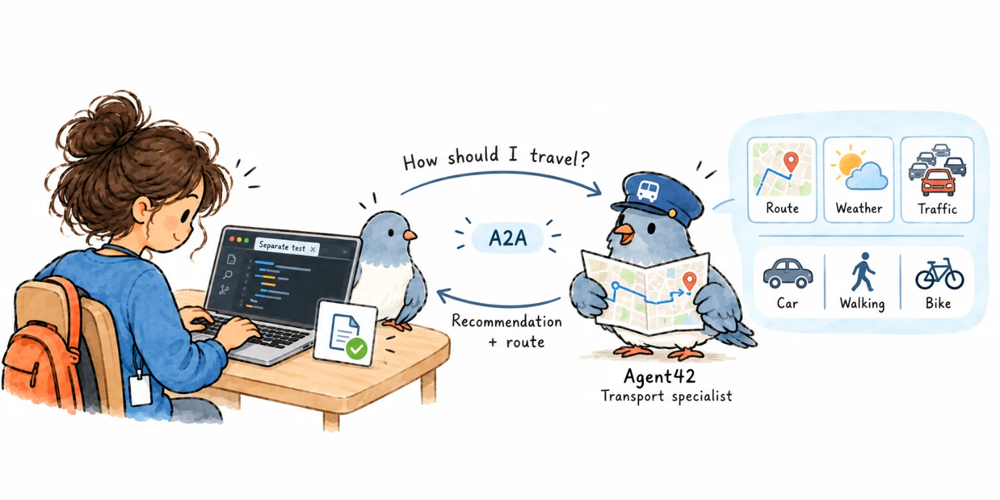
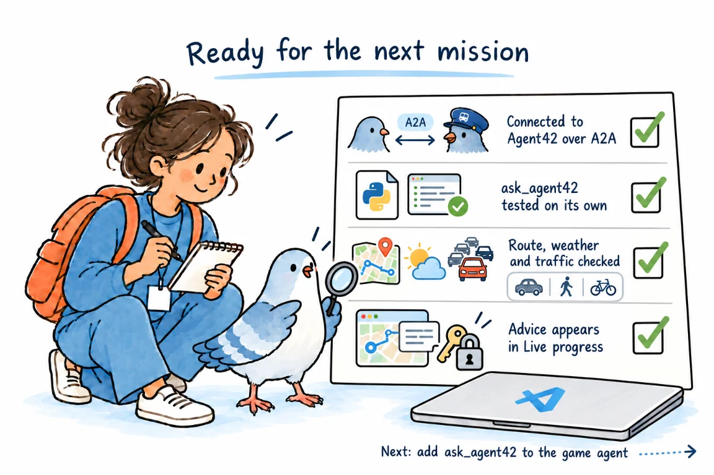

# Agent42 Transport Specialist



Some missions send you across the city, and you choose how to travel: **car**,
**walking**, or **bike**. Instead of guessing, your agent can ask **Agent42**,
a transport specialist that runs as its own agent. Agent42 checks the route, the
live weather, and the traffic, and recommends the best way to go.

Your agent talks to Agent42 over A2A (Agent-to-Agent), so it uses Agent42's
expertise without rebuilding it. In this exercise, you build that connection in
a separate file and test it on its own, before you add Agent42 to your game
agent.

[Read more about A2A](#more-a2a)

## Add endpoint to configuration

Your agent needs the address of Agent42. It uses the same private API key you
already added for the game server, so Agent42 knows which player is asking and
can show its advice on your Player page.

Open the existing **.env** file and add this line. It already contains the
address of the Agent42 service, so you can copy it as it is:

```env
AGENT42_URL={{ agent42_url }}
```

## Create the Agent42 tool


You create a new file, **agent_agent42.py**, that turns Agent42 into a tool your
game agent can use. It does three things:

- **build_agent42_agent()** connects to Agent42 over A2A and sends your API key
  with every request.
- **build_agent42_tool()** wraps that connection as a tool called
  **ask_agent42**. Later, your game agent calls this tool for travel missions.
- **main()** asks Agent42 one test question, so you can check that the
  connection works before you add it to your game agent.

## Create agent_agent42.py

1. In the VS Code Explorer, select the **C:\workshop** folder.
2. Select **New File** and name it **agent_agent42.py**.
3. Copy the code below with the **Copy** button and paste it into
   **agent_agent42.py**. VS Code saves the file automatically.

```python-notype
"""Agent42 transport specialist tool for movement missions."""

import asyncio
import os
from pathlib import Path

import httpx
from agent_framework import FunctionTool
from agent_framework.a2a import A2AAgent
from dotenv import load_dotenv


def build_agent42_agent() -> A2AAgent:
	# Agent42 is a deployed A2A agent. The URL comes from .env.
	timeout = httpx.Timeout(
		float(os.getenv("AGENT42_TIMEOUT_SECONDS", "60")),
		connect=10.0,
	)
	client = httpx.AsyncClient(
		headers={"Authorization": f"Bearer {os.environ['GAME_API_KEY']}"},
		timeout=timeout,
	)
	return A2AAgent(
		name="Agent42",
		description=(
			"Local transport expert. Given an origin and destination, recommends "
			"car/taxi vs walking vs bike using live weather and real-time traffic, "
			"and returns a static map of the chosen route plus a recommendation code."
		),
		url=os.environ["AGENT42_URL"],
		http_client=client,
	)


def build_agent42_tool(agent42: A2AAgent) -> FunctionTool:
	# The main game agent calls this tool for movement quests.
	return agent42.as_tool(
		name="ask_agent42",
		description=(
			"Ask Agent42 for the best way to get from one place to another. "
			"Pass a full natural-language question including origin, destination."
		),
		arg_name="question",
		arg_description="The transport question to send to Agent42.",
	)


async def main() -> None:
	load_dotenv(Path(__file__).with_name(".env"), override=True)

	question = "What is the best way to get from the Ferry Building to Golden Gate Park?"
	async with build_agent42_agent() as agent42:
		response = await agent42.run(question)
		print(response.text)


if __name__ == "__main__":
	asyncio.run(main())
```

Not sure what the code above does? Click the button below for a step-by-step
explanation of each part.

[Explain the code](#more-agent42-code)

## Test Agent42

Run **agent_agent42.py** from the VS Code terminal:

```powershell
python agent_agent42.py
```

Agent42 compares the travel options and recommends one. Its reply looks like
this; the weather, times, links, and recommendation depend on the live route:

```output-read
Weather: <current San Francisco weather>

Options:
Car: <distance, travel time, and pickup wait>
Bike: <distance and travel time>
Walking: <distance and travel time>

Reasoning: <comparison based on the route, weather, and traffic>

map: <generated map URL>
directions: <generated directions URL>
recommendation: <car, bike, or walking>
recommendation code: <generated recommendation code>
```

You can also see the full result on this page. Look at the **Your Quest**
sidebar on the right: a new **Agent42 route advice** entry appears. Click its
dot or label to open the trip details: the weather, the recommended route with its
distance and travel time, a map of the route, and Agent42's full advice.

## What You Learned

You connected your agent to Agent42, a transport specialist that runs as its own
agent, over A2A. You turned Agent42 into a tool called **ask_agent42** and tested
it on its own: Agent42 checked the route, the weather, and the traffic, and
recommended the best way to travel.

Agent42 uses the same private API key as the game server, so its advice also
appears in **Your Quest** on the right. In the next lesson, your game agent gets the
**ask_agent42** tool and asks Agent42 for help on its own.


