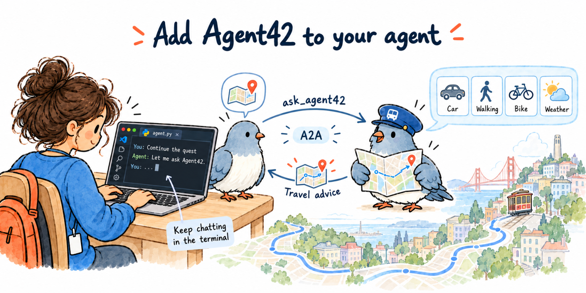
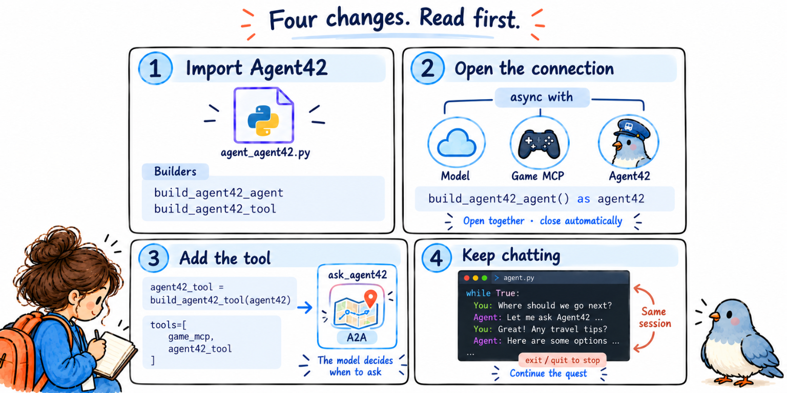
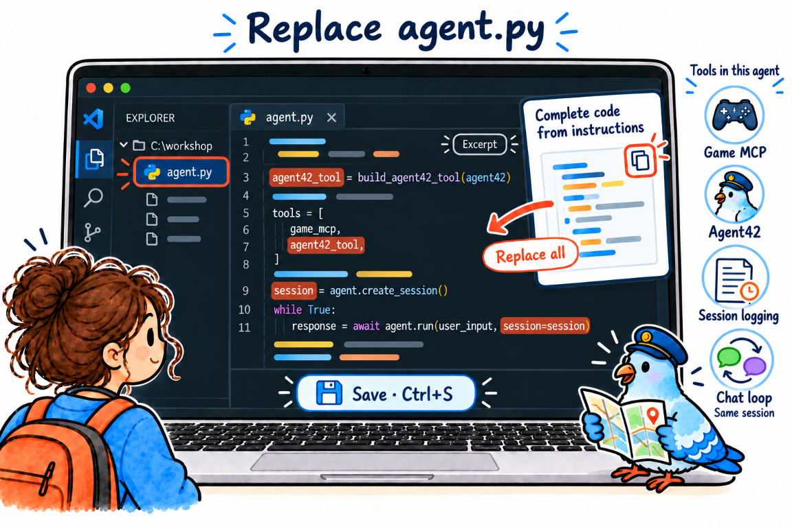
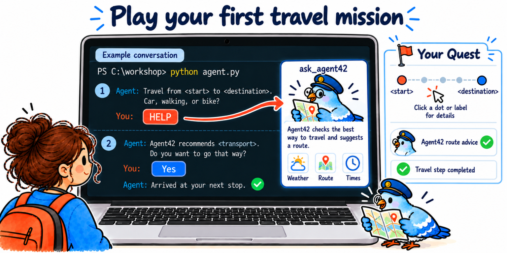
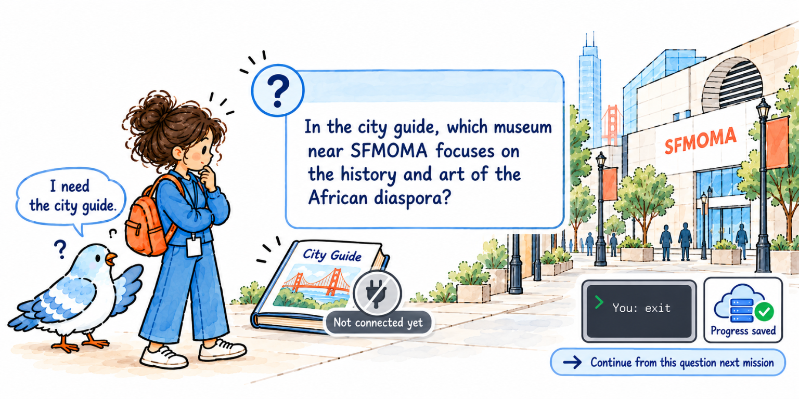
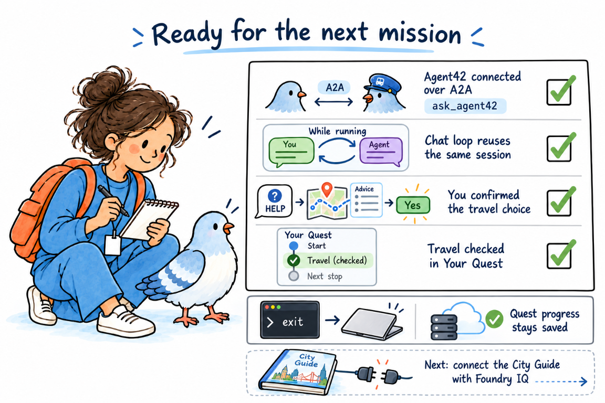

# Add Agent42 To Your Agent



In this exercise, you give your game agent its first specialist. You tested
Agent42 on its own in the previous lesson. Now your game agent gets the
**ask_agent42** tool and asks Agent42 for help by itself when a travel mission
comes up.

You also turn the agent into a chat. Until now, **agent.py** sent two fixed
messages and stopped. After this step, you keep talking to the agent in the
terminal and play the first part of your quest.

## Add Agent42 to the game agent

Your agent needs four changes. Read through them first; at the end you replace
**agent.py** with the complete code.



### 1. Import Agent42

```python-read
from agent_agent42 import build_agent42_agent, build_agent42_tool
```

This loads the two builders from **agent_agent42.py**, the file you created in
the previous lesson.

### 2. Open the Agent42 connection

```python-read
async with (
    client.client,
    game_mcp,
    build_agent42_agent() as agent42,
):
    ...
```

The **async with** block now opens three connections: the model, the game
server, and Agent42. It closes all of them when the block ends, even if
something fails.

### 3. Add Agent42 to the tools

```python-read
agent42_tool = build_agent42_tool(agent42)

agent = Agent(
    client=client,
    name="Game Play Agent",
    instructions=game_play_prompt,
    tools=[game_mcp, agent42_tool],
    middleware=[agent_mw, chat_mw, function_mw],
)
```

**build_agent42_tool()** wraps Agent42 as the **ask_agent42** tool. The game
prompt tells the agent when to ask for help, and the model decides when to call
the tool.

### 4. Keep the conversation going

```python-read
session = agent.create_session()
response = await agent.run("start the game", session=session)
print(f"{PURPLE}Agent:{RESET} {response.text}\n")

while True:
    try:
        user_input = input(f"{GREEN}You:{RESET} ").strip()
    except (EOFError, KeyboardInterrupt):
        print()
        break
    if not user_input:
        continue
    if user_input.lower() in {"exit", "quit"}:
        break
    response = await agent.run(user_input, session=session)
    print(f"{PURPLE}Agent:{RESET} {response.text}\n")
```

The agent starts the game, then waits for your next message. Every message uses
the same **session**, so the agent remembers the whole quest. Type **exit** or
**quit** to stop. **GREEN** and **PURPLE** color your messages and the agent's
replies in the terminal.

## Replace agent.py

Now put the four changes together. Replace everything in **agent.py** with the
code below and save the file. It's the same agent with session logging, now with
Agent42 and a chat loop.



```python-notype
"""Game play agent using Microsoft Agent Framework with Microsoft Foundry."""

import asyncio
import os
from pathlib import Path

from agent_framework import Agent, MCPStreamableHTTPTool
from agent_framework.openai import OpenAIChatClient
from dotenv import load_dotenv

from agent_agent42 import build_agent42_agent, build_agent42_tool
from log import build_logging_middleware, open_session_log

GREEN = "\033[32m"
PURPLE = "\033[35m"
RESET = "\033[0m"


async def main() -> None:
    load_dotenv(Path(__file__).with_name(".env"), override=True)

    client = OpenAIChatClient(
        azure_endpoint=os.environ["AZURE_OPENAI_ENDPOINT"],
        api_key=os.environ["AZURE_OPENAI_API_KEY"],
        model=os.environ["AZURE_OPENAI_DEPLOYMENT_NAME"],
    )

    log_path = open_session_log()
    print(f"Session log: {log_path}")
    agent_mw, chat_mw, function_mw = build_logging_middleware(log_path)

    game_mcp = MCPStreamableHTTPTool(
        name="Gaming MCP Server",
        url=os.environ["GAME_MCP_URL"],
        static_headers={"Authorization": f"Bearer {os.environ['GAME_API_KEY']}"},
    )

    async with (
        client.client,
        game_mcp,
        build_agent42_agent() as agent42,
    ):
        game_play_prompt = await game_mcp.get_prompt("game_play_prompt")
        agent42_tool = build_agent42_tool(agent42)

        agent = Agent(
            client=client,
            name="Game Play Agent",
            instructions=game_play_prompt,
            tools=[game_mcp, agent42_tool],
            middleware=[agent_mw, chat_mw, function_mw],
        )

        print("Chat with Game Play Agent (type 'exit' or 'quit' to stop)\n")
        session = agent.create_session()
        response = await agent.run("start the game", session=session)
        print(f"{PURPLE}Agent:{RESET} {response.text}\n")

        while True:
            try:
                user_input = input(f"{GREEN}You:{RESET} ").strip()
            except (EOFError, KeyboardInterrupt):
                print()
                break
            if not user_input:
                continue
            if user_input.lower() in {"exit", "quit"}:
                break
            response = await agent.run(user_input, session=session)
            print(f"{PURPLE}Agent:{RESET} {response.text}\n")


if __name__ == "__main__":
    asyncio.run(main())
```

## Play the first travel mission



Run the agent from the VS Code terminal:

```powershell
python agent.py
```

The agent picks up your quest where you left it: your first mission asks how
you want to travel. Type **HELP**, and the agent asks Agent42 for advice. Here
is what the conversation looks like. Your route is different, and the agent's
own words can change a little from run to run:

```output-read
Chat with Game Play Agent (type 'exit' or 'quit' to stop)

Agent: Welcome back, {{ player_name }}. You need to get from <start> to <destination>. What transport will you take: car, walking, or bike?

You: HELP

Agent: I asked Agent42. <weather, route, and travel times>. Agent42 recommends <car, bike, or walking>. Do you want to go that way?

You: Yes

Agent: <arrival at your next stop>
```

> [!Hint] Look at the **Your Quest** sidebar on the right. Agent42's route
> advice and your completed quest step appear there. Click a dot or its label
> for more details.

## A question about the city



At your next stop, the game asks a question about the city:
**{{ player_quest_question }}**

The answer is in the {{ game_city }} city guide, and your agent has no way to
look it up yet. It can only guess.

Don't let it guess. Type **exit** to stop the agent. Your progress is saved on
the game server, so you continue from this question in the next mission.

## What You Learned

You connected Agent42 to your game agent by importing its builders, opening
the connection, and adding **agent42_tool** to the agent's tools.

- **Specialist access:** the game agent calls **ask_agent42** to request travel
  advice from Agent42 over A2A. The model selects the tool based on your request
  and the game instructions.
- **Conversation state:** you added a terminal chat loop that reuses the same
  **session**, keeping the conversation context between turns while the agent
  is running.
- **Player choice:** you asked for help, read Agent42's advice, and confirmed
  how to travel before the game agent submitted your choice.
- **Progress checks:** you checked **Your Quest** for Agent42's route advice
  and the completed travel step.

The game server saves your quest progress separately from the chat session,
so typing **exit** stops the agent without losing your place in the quest.

Your agent can now ask for travel advice, but it does not yet have a tool to
look up the city question. In the next lessons, you connect the **City Guide**
through Foundry IQ so the agent can retrieve an answer instead of guessing.


