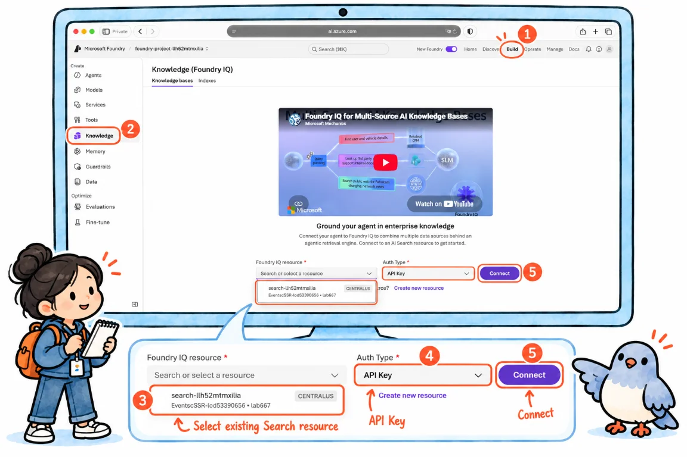
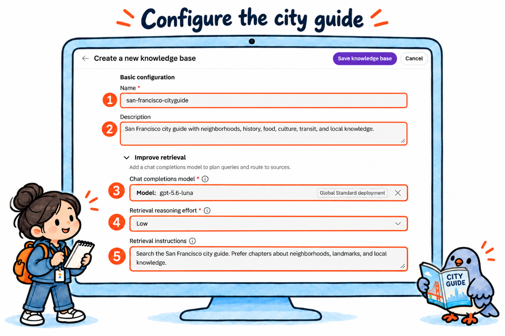
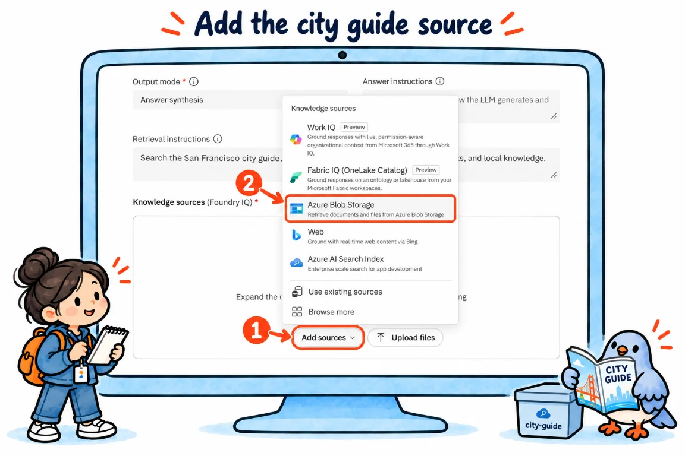
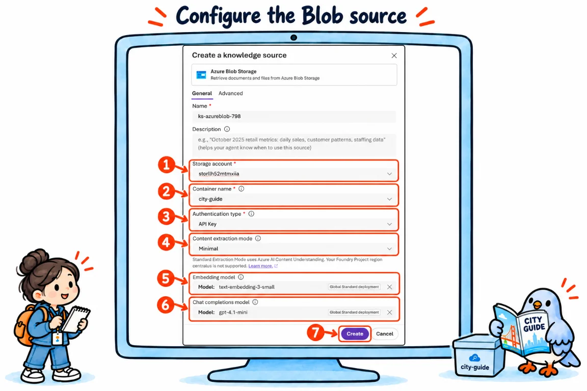
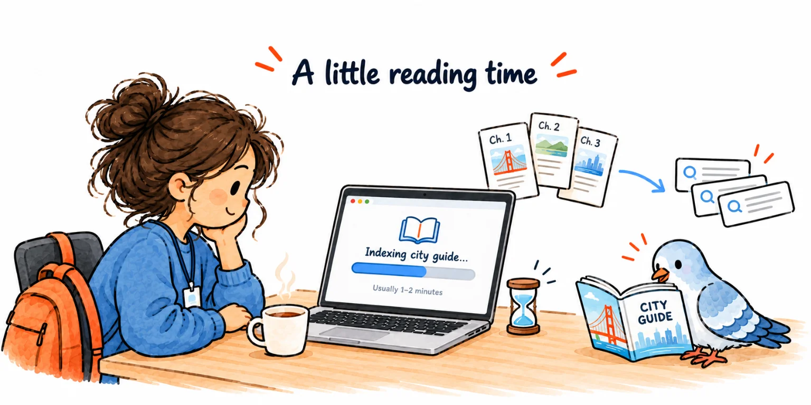
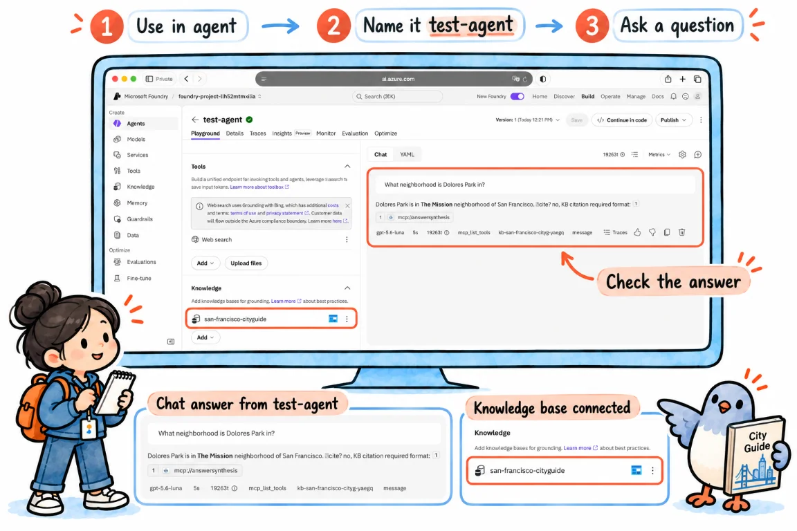
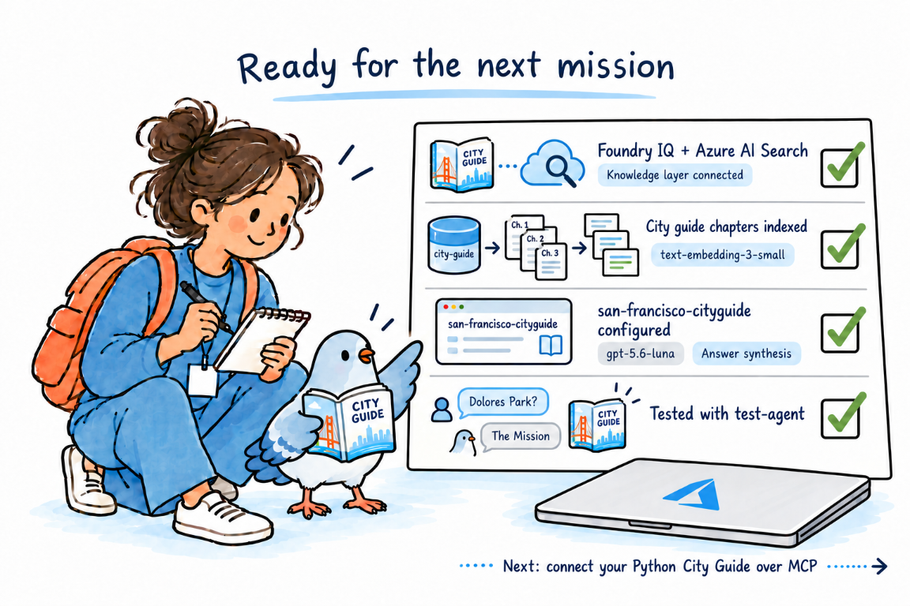

# City Guide Part 1: Create the Knowledge Base

In the previous mission, you stopped at a question from your quest:
**{{ player_quest_question }}**

Instead of guessing, your agent can look up the answer in the {{ game_city }}
city guide.

The city guide lives in a **Foundry IQ** knowledge base. In this part, you
create that knowledge base in the Microsoft Foundry portal and test it there.
In part 2, you prepare its MCP connection for your game agent.

[Read more about Foundry IQ](#more-foundry-iq)

## Connect to the knowledge resource

Foundry IQ stores its knowledge bases in Azure AI Search. Your lab already has
a Search service; you connect it to your Foundry project once.



1. In the Microsoft Foundry portal, select **Build** in the top menu, then
   **Knowledge** in the left menu.
2. For **Foundry IQ resource**, select the resource that starts with
   **search-**. There is only one.
3. For **Auth Type**, keep **API Key**.
4. Select **Connect**.

## Create the knowledge base

The city guide chapters are already uploaded to your lab's storage account, in
a container named **city-guide**. You turn them into a knowledge base. On the
**Knowledge (Foundry IQ)** page, click the **Create a knowledge base** button.

### Basic configuration



Fill in **Name** and **Description**, then expand **Improve retrieval** to
configure the remaining three settings:

| # | Setting | Value |
| --- | --- | --- |
| 1 | **Name** | san-francisco-cityguide |
| 2 | **Description** | San Francisco city guide with neighborhoods, history, food, culture, transit, and local knowledge. |
| 3 | **Chat completions model** | gpt-5.6-luna |
| 4 | **Retrieval reasoning effort** | Low |
| 5 | **Retrieval instructions** | Search the San Francisco city guide. Prefer chapters about neighborhoods, landmarks, and local knowledge. |

### Knowledge sources

A knowledge source is the content your knowledge base searches. Foundry IQ can
combine several, such as files in Blob Storage, SharePoint sites, or the web.
For the City Guide you need just one: the city guide chapters in your lab's
Blob Storage. When you add it, Foundry IQ splits the chapters into small
passages and indexes them, so it can find the right passage for each question.



1. Under **Knowledge sources**, click **Add sources**.
2. Select **Azure Blob Storage**.
3. In the **Create a knowledge source** window, keep the suggested **Name** and
   fill in these settings on the **General** tab:



| # | Setting | Value |
| --- | --- | --- |
| 1 | **Storage account** | The account that starts with **stor**. There is only one. |
| 2 | **Container name** | city-guide |
| 3 | **Authentication type** | API Key |
| 4 | **Content extraction mode** | Minimal |
| 5 | **Embedding model** | text-embedding-3-small |
| 6 | **Chat completions model** | gpt-4.1-mini |

4. Click **Create** at the bottom of the window. The window closes, and your
   new Azure Blob Storage source appears under **Knowledge sources**.
5. Click **Save knowledge base** at the top right of the page. This creates
   the **san-francisco-cityguide** knowledge base with the settings and the
   source you just added.

Foundry IQ now reads the city guide and indexes it. This takes a minute or two.



## Test the knowledge base

Try the knowledge base with a quick test agent in the portal.



1. On the **san-francisco-cityguide** knowledge base page, click
   **Use in an agent**.
2. Name the agent **test-agent** and create it.
   If you see **Use the Microsoft Copilot harness**, leave it at its default
   setting; no action is required.
3. In the agent's chat, ask:

```text
What neighborhood is Dolores Park in?
```

The answer mentions **The Mission**. Under **Knowledge**, you see
**san-francisco-cityguide**, so the answer came from your knowledge base. If it
says it can't find the answer, wait a minute while indexing finishes and ask
again.

## What You Learned



You built the knowledge your City Guide needs, without writing any code:

- **Foundry IQ** is the knowledge layer of Microsoft Foundry. It stores its
  knowledge bases in Azure AI Search, which you connected to your project once.
- A **knowledge source** is the content to search. You added the city guide
  chapters from Blob Storage, and Foundry IQ split them into small passages and
  indexed them with the **text-embedding-3-small** model.
- A **knowledge base** combines one or more sources with the settings for
  searching them. Yours, **san-francisco-cityguide**, plans each search with
  **gpt-5.6-luna** and uses your retrieval instructions to focus on the city
  guide.
- You tested it with **test-agent** in the portal. The answer, **The Mission**,
  came from the city guide, not from what the model already knew.

Every Foundry IQ knowledge base is also an MCP server, so any agent can use it.
In part 2, you prepare a direct MCP connection to **san-francisco-cityguide**
in Python, ready for your game agent.
