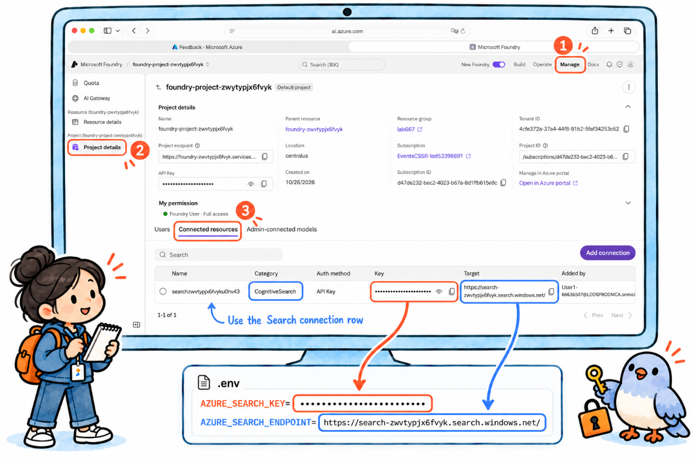

# City Guide Part 2: Connect the Knowledge Base to Your Agent


Your quest asks a question about the city: **{{ player_quest_question }}**
Instead of guessing, your agent can look up the answer in the
**san-francisco-cityguide** knowledge base you created in part 1.

Every Foundry IQ knowledge base is also an MCP server, just like the game
server. It offers one tool, **knowledge_base_retrieve**, that searches the city
guide and writes a short answer. In this exercise, you build that connection in
a separate file and test it on its own, before you add it to your game agent.

[Read more about Foundry IQ](#more-foundry-iq)

## Add endpoint to configuration

Your agent needs the address and key of the Azure AI Search service that stores
your knowledge base. You find both in the Microsoft Foundry portal.

First, open the existing **C:\workshop\.env** file in VS Code and add these
lines. You will replace the two placeholders in the steps below:

```env
AZURE_SEARCH_ENDPOINT=<Target>
AZURE_SEARCH_KEY=<Key>
AZURE_SEARCH_KNOWLEDGE_BASE_NAME=san-francisco-cityguide
```



1. In the Microsoft Foundry portal, select **Manage** in the top menu.
2. Select **Project details** in the left menu.
3. Open the **Connections** tab.
4. Find the Search connection you added in part 1. Its **Category** is
   **CognitiveSearch**.
5. Copy the **Target** value. It looks like
   **https://search-xxxx.search.windows.net/**. In **.env**, replace
   `<Target>` in `AZURE_SEARCH_ENDPOINT` with the copied value.
6. Return to the same row in the portal and copy the **Key** value. In
   **.env**, replace `<Key>` in `AZURE_SEARCH_KEY` with the copied value.

Copy the values from the **Connections** table, not the **Project
endpoint** and **API Key** at the top of the page. Those belong to your
Foundry project, not to Search.

## Create the City Guide tool


You create a new file, **agent_city_guide.py**, that turns the knowledge base
into a tool your game agent can use. It does two things:

- **build_city_guide_tool()** connects to the knowledge base over MCP and sends
  your Search key with every request. Later, your game agent uses this
  connection to call **knowledge_base_retrieve** for city guide questions.
- **main()** creates a small test agent with this tool and asks it one
  question, so you can check that the connection works before you add it to
  your game agent. The test agent uses the same **gpt-5.6-luna** model as your
  game agent.

## Create agent_city_guide.py

1. In the VS Code Explorer, select the **C:\workshop** folder.
2. Select **New File** and name it **agent_city_guide.py**.
3. Copy the code below with the **Copy** button and paste it into
   **agent_city_guide.py**. VS Code saves the file automatically.

```python-notype
"""Direct MCP connection to the San Francisco city guide knowledge base."""

import asyncio
import logging
import os
from collections.abc import AsyncGenerator, Generator
from contextlib import AbstractAsyncContextManager, AsyncExitStack, asynccontextmanager, contextmanager
from contextvars import ContextVar
from pathlib import Path
from typing import Any

from agent_framework import Agent, MCPStreamableHTTPTool
from agent_framework.openai import OpenAIChatClient
from dotenv import load_dotenv
from httpx2 import AsyncClient, Timeout
from mcp import Client, types
from mcp.client.streamable_http import streamable_http_client


class CityGuideClient(Client):
	async def send_ping(self, *, meta: types.RequestParamsMeta | None = None) -> types.EmptyResult:
		# This client uses the legacy protocol, where session pings remain supported.
		return await self.session.send_ping(meta=meta)

	async def list_tools(self, **kwargs: Any) -> types.ListToolsResult:
		result = await super().list_tools(**kwargs)
		tools = []
		for tool in result.tools:
			# AF 1.23 skips optional Tasks even though ordinary calls remain supported.
			if (
				tool.name == "knowledge_base_retrieve"
				and tool.execution is not None
				and tool.execution.task_support == "optional"
			):
				tool = tool.model_copy(update={"execution": None})
			tools.append(tool)
		return result.model_copy(update={"tools": tools})


@contextmanager
def configured_legacy_notifications() -> Generator[None, None, None]:
	"""Hide only AF 1.23's inaccurate setup warning after wiring its handler."""
	scope = ContextVar("city_guide_legacy_setup", default=False)
	token = scope.set(True)
	logger = logging.getLogger("agent_framework._mcp")

	def keep_record(record: logging.LogRecord) -> bool:
		return not (
			scope.get()
			and record.levelno == logging.WARNING
			and record.getMessage() == (
				"Automatic legacy catalog refresh is unavailable for a caller-owned Client; "
				"configure legacy notification handling when constructing the Client."
			)
		)

	logger.addFilter(keep_record)
	try:
		yield
	finally:
		logger.removeFilter(keep_record)
		scope.reset(token)


def build_city_guide_tool() -> AbstractAsyncContextManager[MCPStreamableHTTPTool]:
	search_endpoint = os.environ["AZURE_SEARCH_ENDPOINT"].rstrip("/")
	knowledge_base = os.environ["AZURE_SEARCH_KNOWLEDGE_BASE_NAME"]
	search_key = os.environ["AZURE_SEARCH_KEY"]
	url = f"{search_endpoint}/knowledgebases/{knowledge_base}/mcp?api-version=2026-08-01-preview"

	@asynccontextmanager
	async def connect() -> AsyncGenerator[MCPStreamableHTTPTool, None]:
		async with AsyncClient(
			headers={"api-key": search_key},
			timeout=Timeout(60.0, read=300.0),
			follow_redirects=False,
		) as http_client:
			transport = streamable_http_client(url, http_client=http_client)
			mcp_client = CityGuideClient(transport, mode="legacy")
			city_guide = MCPStreamableHTTPTool(
				name="City Guide Knowledge Base",
				mcp_client=mcp_client,
				allowed_tools=["knowledge_base_retrieve"],
				load_prompts=False,
			)
			mcp_client.message_handler = city_guide.message_handler
			async with mcp_client, AsyncExitStack() as stack:
				with configured_legacy_notifications():
					await stack.enter_async_context(city_guide)
				if not any(tool.name == "knowledge_base_retrieve" for tool in city_guide.functions):
					raise RuntimeError(
						"The knowledge base did not expose knowledge_base_retrieve. "
						"Check Search permissions and tool metadata; required MCP Tasks are not supported."
					)
				yield city_guide

	return connect()


async def main() -> None:
	load_dotenv(Path(__file__).with_name(".env"), override=True)

	client = OpenAIChatClient(
		azure_endpoint=os.environ["AZURE_OPENAI_ENDPOINT"],
		api_key=os.environ["AZURE_OPENAI_API_KEY"],
		model=os.environ["AZURE_OPENAI_DEPLOYMENT_NAME"],
	)

	async with client.client, build_city_guide_tool() as city_guide:
		if not any(tool.name == "knowledge_base_retrieve" for tool in city_guide.functions):
			raise RuntimeError("The knowledge base did not expose knowledge_base_retrieve.")
		test_agent = Agent(
			client=client,
			name="City Guide Test Agent",
			instructions=(
				"Always call knowledge_base_retrieve to answer the question. "
				"Answer only from the knowledge base result, not from memory. "
				"Keep the answer brief."
			),
			tools=[city_guide],
		)
		response = await test_agent.run("What neighborhood is Dolores Park in?")
		print(response.text)


if __name__ == "__main__":
	asyncio.run(main())
```

Not sure what the code above does? Click the button below for a step-by-step
explanation of each part.

[Explain the code](#more-city-guide-code)

## Test the City Guide

Run **agent_city_guide.py** from the VS Code terminal:

```powershell
python agent_city_guide.py
```

The test agent asks where Dolores Park is, and the knowledge base answers from
the city guide. The exact wording can differ, but it looks like this:

```output-read
Dolores Park is in the Mission District.
```

If the script can't connect, check the three **AZURE_SEARCH_** lines in
**.env**.

If an older copy reports **Skipping MCP tool 'knowledge_base_retrieve'** because
of the **Tasks extension**, replace the full file with the sample above.
Azure AI Search can advertise optional Tasks support. **CityGuideClient** keeps
ordinary retrieval calls available with Agent Framework 1.23; tools that require
Tasks remain blocked.

The sample also wires legacy tool-list notifications and uses a supported
session ping for connection checks. It filters only the framework's redundant
catalog-setup notice during this connection's setup. If an older copy shows
that notice or **MCPDeprecationWarning** about `ping`, copy the updated file
above. Real connection errors, retrieval failures, and other warnings remain
visible; do not disable warnings globally.

## What You Learned

You connected your agent to your Foundry IQ knowledge base over MCP and tested
it on its own: the test agent called **knowledge_base_retrieve**, and the
knowledge base answered from the city guide.

The knowledge base already searches and writes the answer, so you don't need
a separate City Guide agent. In the next mission, your game agent gets this
connection next to **ask_agent42** and looks up city guide questions on its
own.


