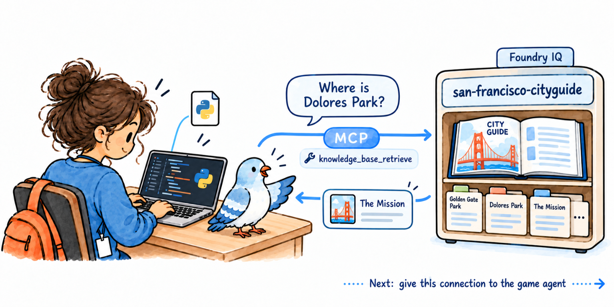

# City Guide Part 2: Connect the Knowledge Base to Your Agent



Your quest asks a question about the city: **{{ player_quest_question }}**
Instead of guessing, your agent can look up the answer in the
**san-francisco-cityguide** knowledge base you created in part 1.

Every Foundry IQ knowledge base is also an MCP server, just like the game
server. It offers one tool, **knowledge_base_retrieve**, that searches the city
guide and writes a short answer. In this exercise, you build that connection in
a separate file and test it on its own, before you add it to your game agent.

[Read more about Foundry IQ](#more-foundry-iq)

## Add endpoint to configuration

Your agent needs the address and key of the Azure AI Search service that stores
your knowledge base. You find both in the Microsoft Foundry portal.


1. In the Microsoft Foundry portal, select **Manage** in the top menu.
2. Select **Project details** in the left menu.
3. Open the **Connected resources** tab.
4. Find the Search connection you added in part 1. Its **Category** is
   **CognitiveSearch**.
5. Copy the **Target** value. It looks like
   **https://search-xxxx.search.windows.net/**.
6. Copy the **Key** value from the same row.

Copy the values from the **Connected resources** table, not the **Project
endpoint** and **API Key** at the top of the page. Those belong to your
Foundry project, not to Search.

Open the existing **.env** file, add these lines, and replace the two
placeholders with the **Target** and **Key** you copied:

```env
AZURE_SEARCH_ENDPOINT=<Target>
AZURE_SEARCH_KEY=<Key>
AZURE_SEARCH_KNOWLEDGE_BASE_NAME=san-francisco-cityguide
```

## Create the City Guide tool


You create a new file, **agent_city_guide.py**, that turns the knowledge base
into a tool your game agent can use. It does two things:

- **build_city_guide_tool()** connects to the knowledge base over MCP and sends
  your Search key with every request. Later, your game agent uses this
  connection to call **knowledge_base_retrieve** for city guide questions.
- **main()** creates a small test agent with this tool and asks it one
  question, so you can check that the connection works before you add it to
  your game agent. The test agent uses the same **gpt-5.6-luna** model as your
  game agent.

## Create agent_city_guide.py

1. In the VS Code Explorer, select the **C:\workshop** folder.
2. Select **New File** and name it **agent_city_guide.py**.
3. Copy the code below with the **Copy** button and paste it into
   **agent_city_guide.py**. VS Code saves the file automatically.

```python-notype
"""Direct MCP connection to the San Francisco city guide knowledge base."""

import asyncio
import os
from pathlib import Path

from agent_framework import Agent, MCPStreamableHTTPTool
from agent_framework.openai import OpenAIChatClient
from dotenv import load_dotenv


def build_city_guide_tool() -> MCPStreamableHTTPTool:
	search_endpoint = os.environ["AZURE_SEARCH_ENDPOINT"].rstrip("/")
	knowledge_base = os.environ["AZURE_SEARCH_KNOWLEDGE_BASE_NAME"]
	return MCPStreamableHTTPTool(
		name="City Guide Knowledge Base",
		url=f"{search_endpoint}/knowledgebases/{knowledge_base}/mcp?api-version=2026-08-01-preview",
		static_headers={"api-key": os.environ["AZURE_SEARCH_KEY"]},
		allowed_tools=["knowledge_base_retrieve"],
		load_prompts=False,
	)


async def main() -> None:
	load_dotenv(Path(__file__).with_name(".env"), override=True)

	client = OpenAIChatClient(
		azure_endpoint=os.environ["AZURE_OPENAI_ENDPOINT"],
		api_key=os.environ["AZURE_OPENAI_API_KEY"],
		model=os.environ["AZURE_OPENAI_DEPLOYMENT_NAME"],
	)

	async with client.client, build_city_guide_tool() as city_guide:
		if not any(tool.name == "knowledge_base_retrieve" for tool in city_guide.functions):
			raise RuntimeError("The knowledge base did not expose knowledge_base_retrieve.")
		test_agent = Agent(
			client=client,
			name="City Guide Test Agent",
			instructions=(
				"Always call knowledge_base_retrieve to answer the question. "
				"Answer only from the knowledge base result, not from memory. "
				"Keep the answer brief."
			),
			tools=[city_guide],
		)
		response = await test_agent.run("What neighborhood is Dolores Park in?")
		print(response.text)


if __name__ == "__main__":
	asyncio.run(main())
```

Not sure what the code above does? Click the button below for a step-by-step
explanation of each part.

[Explain the code](#more-city-guide-code)

## Test the City Guide

Run **agent_city_guide.py** from the VS Code terminal:

```powershell
python agent_city_guide.py
```

The test agent asks where Dolores Park is, and the knowledge base answers from
the city guide. The exact wording can differ, but it looks like this:

```output-read
Dolores Park is in the Mission District.
```

If the script can't connect, check the three **AZURE_SEARCH_** lines in
**.env**.

## What You Learned

You connected your agent to your Foundry IQ knowledge base over MCP and tested
it on its own: the test agent called **knowledge_base_retrieve**, and the
knowledge base answered from the city guide.

The knowledge base already searches and writes the answer, so you don't need
a separate City Guide agent. In the next mission, your game agent gets this
connection next to **ask_agent42** and looks up city guide questions on its
own.


