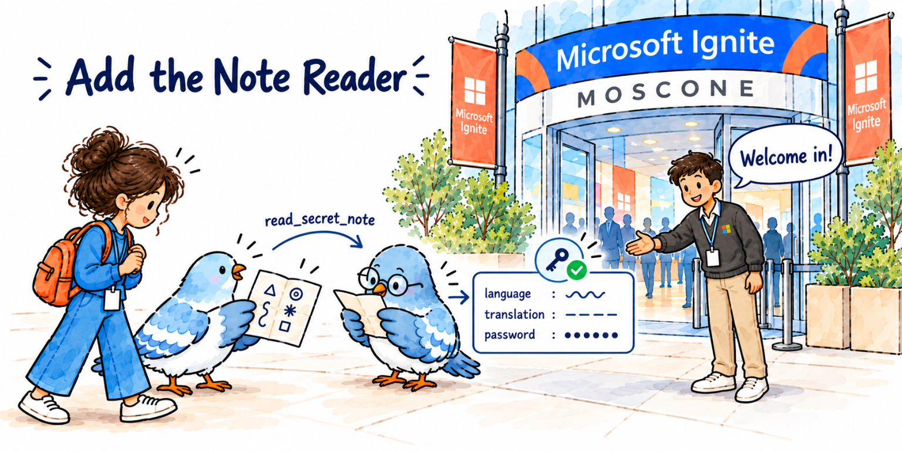
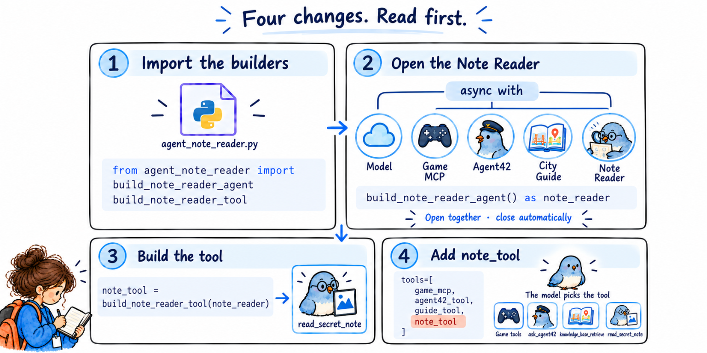
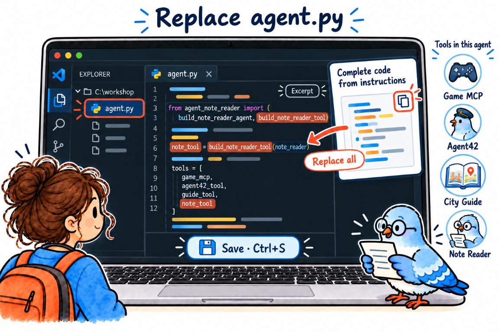
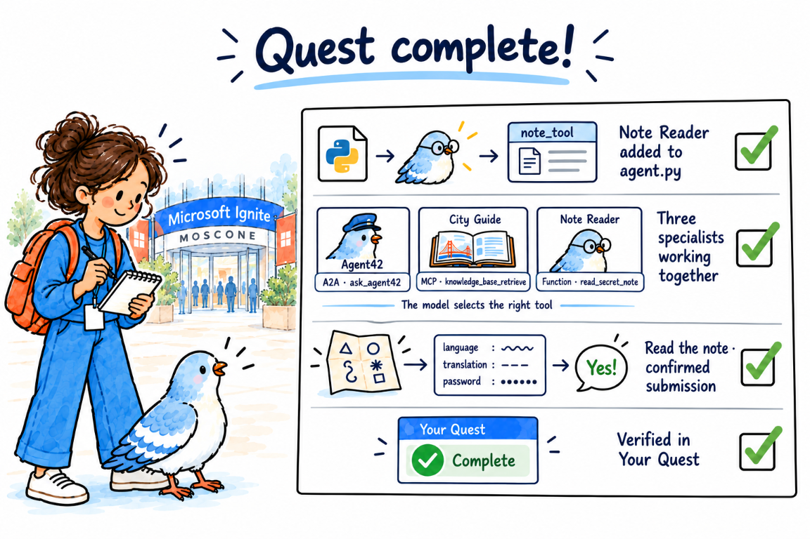

# Add The Note Reader To Your Agent



In this exercise, you give your game agent its last specialist: the **Note
Reader**. In the previous mission, you stopped at the door of Microsoft Ignite
because the host asked for a secret password. Now your game agent gets the
**read_secret_note** tool, reads the note, and gets you through the door.

## Add the Note Reader to the game agent

Your agent needs four changes. Read through them first; at the end you replace
**agent.py** with the complete code.



### 1. Import the Note Reader

```python-read
from agent_note_reader import build_note_reader_agent, build_note_reader_tool
```

This loads the two builders from **agent_note_reader.py**, the file you created
in the previous lesson.

### 2. Open the Note Reader

```python-read
async with (
    client.client,
    game_mcp,
    build_agent42_agent() as agent42,
    build_city_guide_tool() as guide_tool,
    build_note_reader_agent() as note_reader,
):
    ...
```

The **async with** block now opens five connections: the model, the game server,
Agent42, the City Guide knowledge base, and the Note Reader. It closes all of
them when the block ends, even if something fails.

### 3. Build the Note Reader tool

```python-read
note_tool = build_note_reader_tool(note_reader)
```

**build_note_reader_tool()** wraps the Note Reader as the **read_secret_note**
tool.

### 4. Add the Note Reader to the tools

```python-read
agent = Agent(
    client=client,
    name="Game Play Agent",
    instructions=game_play_prompt,
    tools=[game_mcp, agent42_tool, guide_tool, note_tool],
    middleware=[agent_mw, chat_mw, function_mw],
)
```

The game agent now has four kinds of help: the game tools, **ask_agent42**,
**knowledge_base_retrieve**, and **read_secret_note**. The model picks the right
one for each mission.

## Replace agent.py

Now put the four changes together. Replace everything in **agent.py** with the
code below and save the file. It's the same agent you played with in the
previous mission, now with the Note Reader.



```python-notype
"""Game play agent using Microsoft Agent Framework with Microsoft Foundry."""

import asyncio
import os
from pathlib import Path

from agent_framework import Agent, MCPStreamableHTTPTool
from agent_framework.openai import OpenAIChatClient
from dotenv import load_dotenv

from agent_agent42 import build_agent42_agent, build_agent42_tool
from agent_city_guide import build_city_guide_tool
from agent_note_reader import build_note_reader_agent, build_note_reader_tool
from log import build_logging_middleware, open_session_log

GREEN = "\033[32m"
PURPLE = "\033[35m"
RESET = "\033[0m"


async def main() -> None:
    load_dotenv(Path(__file__).with_name(".env"), override=True)

    client = OpenAIChatClient(
        azure_endpoint=os.environ["AZURE_OPENAI_ENDPOINT"],
        api_key=os.environ["AZURE_OPENAI_API_KEY"],
        model=os.environ["AZURE_OPENAI_DEPLOYMENT_NAME"],
    )

    log_path = open_session_log()
    print(f"Session log: {log_path}")
    agent_mw, chat_mw, function_mw = build_logging_middleware(log_path)

    game_mcp = MCPStreamableHTTPTool(
        name="Gaming MCP Server",
        url=os.environ["GAME_MCP_URL"],
        static_headers={"Authorization": f"Bearer {os.environ['GAME_API_KEY']}"},
    )

    async with (
        client.client,
        game_mcp,
        build_agent42_agent() as agent42,
        build_city_guide_tool() as guide_tool,
        build_note_reader_agent() as note_reader,
    ):
        game_play_prompt = await game_mcp.get_prompt("game_play_prompt")
        agent42_tool = build_agent42_tool(agent42)
        note_tool = build_note_reader_tool(note_reader)

        agent = Agent(
            client=client,
            name="Game Play Agent",
            instructions=game_play_prompt,
            tools=[game_mcp, agent42_tool, guide_tool, note_tool],
            middleware=[agent_mw, chat_mw, function_mw],
        )

        print("Chat with Game Play Agent (type 'exit' or 'quit' to stop)\n")
        session = agent.create_session()
        response = await agent.run("start the game", session=session)
        print(f"{PURPLE}Agent:{RESET} {response.text}\n")

        while True:
            try:
                user_input = input(f"{GREEN}You:{RESET} ").strip()
            except (EOFError, KeyboardInterrupt):
                print()
                break
            if not user_input:
                continue
            if user_input.lower() in {"exit", "quit"}:
                break
            response = await agent.run(user_input, session=session)
            print(f"{PURPLE}Agent:{RESET} {response.text}\n")


if __name__ == "__main__":
    asyncio.run(main())
```

## Get through the door

Run the agent from the VS Code terminal:

```powershell
python agent.py
```

The agent picks up your quest at the door. The game shows a link to a picture of
your note in the conversation. Open it if you're curious. Type **HELP**, and the
agent calls **read_secret_note** with that link. Here is what the conversation
looks like. The agent's own words can change a little from run to run:

```output-read
Chat with Game Play Agent (type 'exit' or 'quit' to stop)

Agent: Welcome back, {{ player_name }}. You remember the folded piece of paper from the start of your journey. You unfold it and see words in a strange language you have never seen before. Oh... you need some help with this one.

Your note: <link to the picture of your note>

What is the secret password?

You: HELP

Agent: The note is written in <language>. It says: <translation>. The password is <password>. Do you want to give it to the host?

You: Yes

Agent: <the host lets you in>. Welcome in! <final scene of your quest>
```

> [!Hint] To try another note, paste the sample note link from the previous
> lesson and ask the agent to read it. Use an image URL that the model can access.

> **Checkpoint:** the agent confirms that your quest is complete, and the
> **Your Quest** sidebar on the right shows every quest step as completed
> and the **End** marker filled in. Click **Quest started** to read the full
> **Story so far**, including the ending.

## What You Learned

You connected the Note Reader to your game agent by importing its builders,
opening the specialist, building **note_tool**, and adding it to the agent's
tools.

Your game agent now has three specialists:

- **Agent42**, reached over A2A through **ask_agent42**, provides travel advice.
- **The City Guide**, reached over MCP through **knowledge_base_retrieve**,
  retrieves answers from the data in Foundry IQ.
- **The Note Reader**, called through your custom **read_secret_note**
  function tool, reads a note image and returns its language, translation,
  and password as structured output.

The model selects tools based on your request and the game instructions. You
asked it to read the note, confirmed the password submission, and checked
**Your Quest** to verify that the quest was complete.


