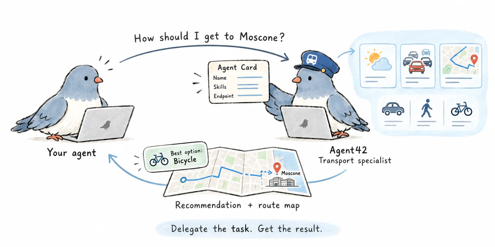

# A2A: Agent-to-Agent

A2A is an open protocol that lets agents work together, even when they are
built with different frameworks or run by different teams. MCP gives your
agent tools to call; A2A lets your agent hand a task to another agent that
reasons and uses its own tools.

## How it works

- **Agent Card**: every A2A agent publishes a JSON description at
  **/.well-known/agent-card.json** with its name, skills, endpoint, and how to
  authenticate.
- **Messages and tasks**: your agent sends a message over HTTP. The remote
  agent works on it and returns a reply or a task result, such as text or a
  file.
- **Opaque by design**: your agent never sees the other agent's prompts, tools,
  or model. It only uses the published interface.

## In this workshop

**Agent42** is a transport specialist that runs as a separate A2A service. When
a mission asks you to travel across {{ game_city }}, your agent asks Agent42 how
to get there. Agent42 checks the weather, traffic, and routes with Azure Maps,
compares car, walking, and bike, and replies with a recommendation and a route
map. The advice also appears in the **Your Quest** sidebar on the right.
Click its dot or label to open the trip details.

In code, your agent uses **A2AAgent** from the Microsoft Agent Framework and
wraps it as a tool that the main agent can call.

## MCP or A2A?

- **MCP**: "call this function." Your agent stays in charge and uses the tool.
- **A2A**: "handle this for me." Another agent with its own expertise decides
  how.
