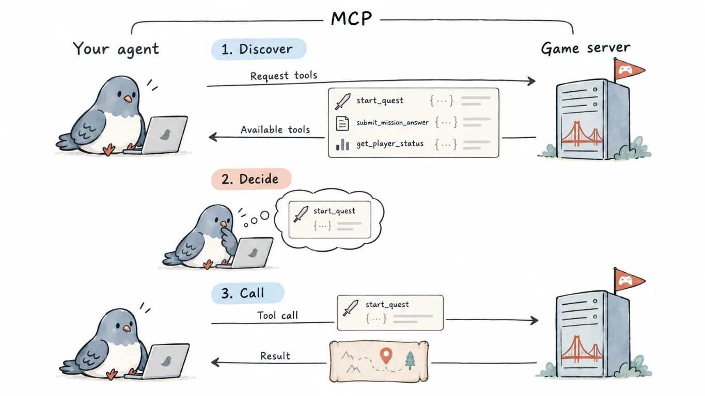

# MCP: Model Context Protocol

MCP is an open standard for connecting AI applications to tools and data.
Instead of writing custom integration code for every service, a service
publishes an **MCP server**, and any MCP-compatible agent can use it as an
**MCP client**.

## How it works

1. **Discover**: when your agent connects, it asks the server which tools it
   offers. Each tool has a name, a description, and an input schema.
2. **Decide**: the model reads those descriptions and decides when to call a
   tool and with which arguments.
3. **Call**: the agent sends the tool call to the server and passes the result
   back to the model.

Servers can also share resources, such as files, and reusable prompts. Remote
servers are reached over HTTP.

## In this workshop

The **{{ game_name }}** game server is an MCP server. Its tools let your agent
play the game:

- **begin_session** and **resume_player**: start or continue as your player.
- **start_quest**: receive a quest and its first mission.
- **submit_mission_answer**: answer a mission and move to the next one.
- **get_player_status**: check where you are in the game.

Your agent connects with **MCPStreamableHTTPTool** from the Microsoft Agent
Framework and sends your Player API key, so the server knows who is playing.
You don't code the game rules into your agent. It learns them from the tool
descriptions.

Add or swap an MCP server and your agent gains new abilities without new
integration code.
